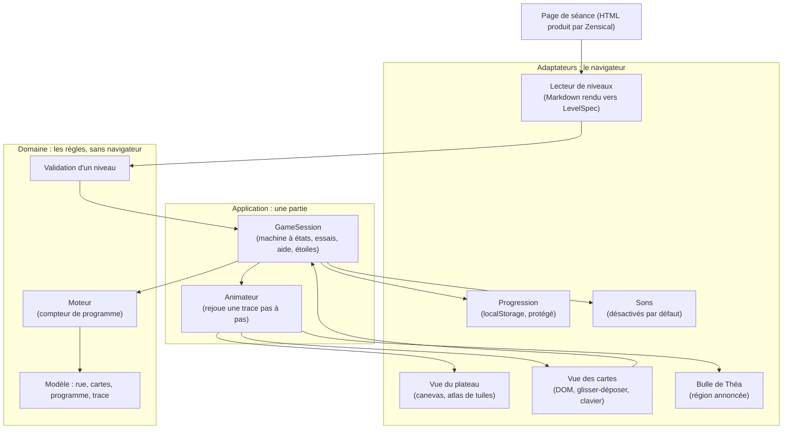
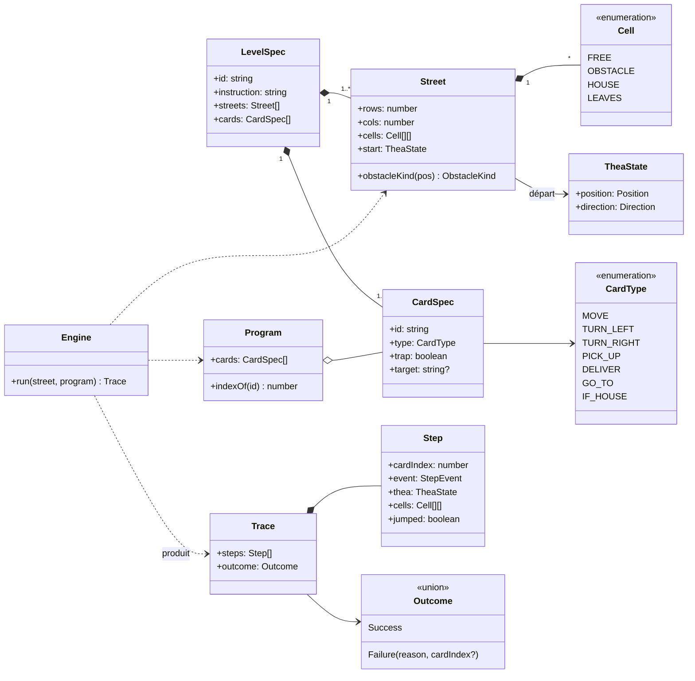
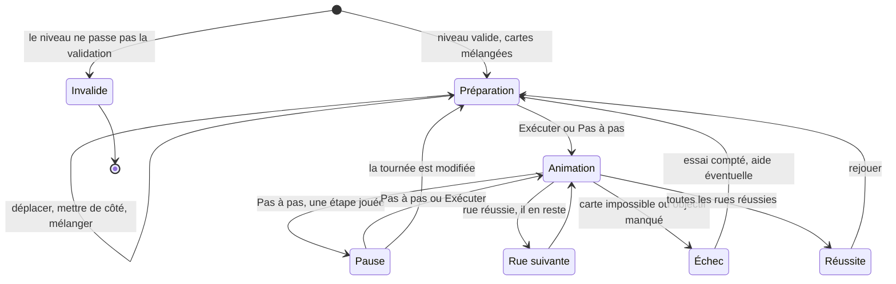
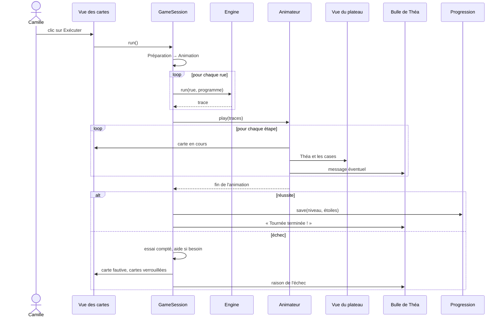

# Architecture

V. Guidoux, avec l'aide de Claude.

Ce travail est sous licence [CC BY-SA 4.0][licence].

Ce document décrit comment le jeu sera construit : ses couches, son modèle, son
déroulement, l'organisation du code et la façon de le tester. Il s'appuie sur
les [besoins](03-besoins.md) et la [conception du jeu](04-conception-du-jeu.md).
Chaque choix important a son ADR dans [`decisions/`](decisions/).

## Les forces en présence

Ce qui pèse le plus sur l'architecture, tiré des besoins :

1. **L'enseignant écrit les niveaux en Markdown**, sans toucher au code (US-20).
   Le format des niveaux est une interface publique : il doit rester stable.
2. **Une autre personne doit pouvoir reprendre le code** (US-30 à US-33) : les
   règles du jeu doivent être lisibles et testées sans navigateur.
3. **Le site est statique** : pas de serveur, un fichier JavaScript construit et
   figé dans le dépôt, comme CodeMirror.
4. **Le jeu vit dans les pages des séances**, à côté des quiz et des problèmes
   de Parsons : plusieurs niveaux par page, chargement léger.
5. **Accessibilité et mobile** : clavier complet, lecteur d'écran, doigt.

## Vue d'ensemble : un cœur pur, une coquille d'adaptateurs

Le style retenu est celui du **cœur fonctionnel et de la coquille impérative**,
proche de l'architecture hexagonale
([ADR 0003](decisions/0003-coeur-pur-et-adaptateurs.md)). Les règles du jeu ne
connaissent ni le DOM, ni le canevas, ni le stockage : elles reçoivent des
données et rendent des données. Tout ce qui touche au navigateur vit dans des
adaptateurs, à la périphérie.



Trois couches, et une règle de dépendance : **une couche ne connaît que celles
qui sont en dessous d'elle**. Le domaine ne connaît personne.

| Couche      | Contient                                                     | Testée par                        |
| :---------- | :----------------------------------------------------------- | :-------------------------------- |
| Domaine     | Rue, cartes, programme, moteur, validation, trace            | Tests unitaires, sans DOM         |
| Application | Session de jeu (états, essais, aide, étoiles), animateur     | Tests unitaires, faux adaptateurs |
| Adaptateurs | Lecture du Markdown, canevas, DOM des cartes, stockage, sons | Tests d'intégration, navigateur   |

## Le modèle du domaine



Quatre principes :

- **Tout est immuable.** Le moteur ne modifie pas la rue : chaque étape porte un
  instantané de l'état (position de Théa, cases). C'est ce qui permet de rejouer
  une exécution, de revenir en arrière, et de tester simplement.
- **Une exécution est d'abord calculée, puis animée**
  ([ADR 0005](decisions/0005-execution-precalculee.md)). Le moteur rend la trace
  complète en une fois ; l'animateur la rejoue. La logique ne dépend jamais du
  temps ni de l'animation.
- **Le programme est une liste plate**, et les sauts désignent une carte par son
  identifiant, pas par sa position
  ([ADR 0004](decisions/0004-sauts-plutot-que-cartes-imbriquees.md)). Le numéro
  affiché est calculé à l'affichage.
- **Le résultat est une donnée**, pas une exception : `Success`, ou `Failure`
  avec sa raison (`FELL_IN_POND`, `FELL_IN_HOLE`, `LEFT_TOWN`,
  `NOTHING_TO_PICK`, `NOBODY_HERE`, `ROUND_NOT_FINISHED`, `LOOPS_FOREVER`,
  `EXTRA_CARD`) et la carte fautive. Les messages en français sont choisis par
  l'application, pas par le moteur.

### Les patrons de conception, là où ils servent

| Patron       | Où                                                  | Pourquoi                                                            |
| :----------- | :-------------------------------------------------- | :------------------------------------------------------------------ |
| Interpréteur | Le moteur, avec son compteur de programme           | Exécuter une liste de cartes comme une machine notionnelle          |
| Commande     | Une carte = une instruction avec son effet          | Ajouter une carte en un seul endroit (US-33)                        |
| État         | `GameSession`                                       | Interdire les actions impossibles (déplacer pendant l'animation)    |
| Observateur  | La session émet des événements, les vues s'abonnent | Plusieurs vues, aucune ne connaît les autres                        |
| Dépôt        | La progression derrière une interface               | `localStorage` aujourd'hui, autre chose demain, faux dans les tests |
| Fabrique     | Du mot du Markdown (`avancer`) à la carte           | Un seul endroit qui connaît le vocabulaire des niveaux              |

On évite les patrons qui ne servent pas encore. Pas de moteur de jeu, pas
d'injection de dépendances : des fonctions, des types, et des objets passés en
paramètres.

### Ajouter une carte

C'est le test de l'architecture (US-33). Ajouter « répéter 3 fois », par
exemple, demande de toucher :

1. le type `CardType` et la fabrique (le mot du Markdown) ;
2. l'effet de la carte dans le moteur, et ses tests ;
3. son icône et sa phrase dans la vue des cartes.

Rien d'autre : ni la session, ni l'animateur, ni le plateau.

## Le cycle de vie d'un niveau



La session refuse toute action qui n'a pas de flèche dans ce diagramme. C'est
elle, et elle seule, qui compte les essais, déclenche l'aide (une carte de plus
verrouillée à chaque échec après le troisième) et attribue les étoiles.

## Une exécution, de bout en bout



## Le format des niveaux

Le format est une interface publique
([ADR 0006](decisions/0006-format-des-niveaux-en-markdown.md)). Il est lu dans
le HTML produit par Zensical, pas dans le Markdown brut : le script trouve les
blocs `div.thealivery` de la page.

````markdown
<div class="thealivery" data-id="s07-la-rue-qui-s-allonge" markdown>

Le même programme doit livrer les deux rues.

```text
T> .  .  M
```

```text
T> .  .  .  .  M
```

1. avancer {#debut}
2. si-maison -> fin
3. aller -> debut
4. livrer {#fin}

</div>
````

- **Grille** : un bloc `text` par rue. `T>` `T<` `T^` `Tv` Théa et sa direction,
  `.` libre, `~` obstacle, `M` maison, `f` feuilles.
- **Cartes** : une liste, dans un ordre qui réussit. Un mot par carte :
  `avancer`, `tourner-gauche`, `tourner-droite`, `ramasser`, `livrer`, `aller`,
  `si-maison`.
- **Pièges** : préfixe `piège :`.
- **Sauts** : la carte visée porte une étiquette `{#nom}`, et le saut la désigne
  avec `-> nom`, en caractères simples, faciles à taper sur tous les claviers.
- **Validation** : les sept erreurs de la conception du jeu, plus deux pour les
  sauts (étiquette inconnue, étiquette en double), et la boucle infinie de la
  solution. Le niveau invalide est remplacé par son message, dans la page et
  dans la console.

Une vérification hors navigateur relit toutes les pages du site et valide chaque
niveau, comme `check-presentations.py` pour les diapositives : un niveau
impossible ne peut pas être publié (US-24).

## Le plateau : un atlas et un rendu au hasard reproductible

Le plateau est dessiné dans le navigateur, sur un canevas, à partir d'un
**atlas** : une seule image qui contient uniquement les tuiles utilisées, et un
fichier qui donne leur position
([ADR 0007](decisions/0007-rendu-canevas-et-atlas.md)).

- L'atlas est construit une fois par un script, à partir du pack Ninja
  Adventure, et figé dans le dépôt avec sa licence
  ([ADR 0008](decisions/0008-pixel-art-ninja-adventure.md)).
- Le rendu reprend exactement les règles de `niveaux/generer.py` : rues de trois
  tuiles, coins intérieurs, mares recolorées, chemins qui s'arrêtent avant les
  obstacles, décor tiré au hasard. Le script Python devient la **référence** :
  le rendu TypeScript est testé en comparant ses images aux siennes.
- Le hasard est **reproductible** : un générateur pseudo-aléatoire initialisé
  avec l'identifiant du niveau. La même page montre toujours le même quartier.

## L'organisation du code

Le code source n'est pas publié : il vit dans `outils/thealivery/`, comme la
recette de CodeMirror. Seul le résultat construit va dans `docs/`
([ADR 0002](decisions/0002-typescript-esbuild-fichier-fige.md)).

```text
outils/thealivery/
  package.json               versions figées, scripts build, test, lint, check
  tsconfig.json              TypeScript strict
  src/
    domaine/                 sans navigateur
      street.ts              rue, cases, positions, directions
      cards.ts               types de cartes, fabrique depuis le mot
      level.ts               niveau validé, solution sans les pièges
      program.ts             zones : programme principal, routines, numéros
      engine.ts              moteur, compteur de programme, pile d'appels, trace
      validation.ts          validation d'un niveau
    application/
      session.ts             machine à états, essais, aide, étoiles
      animator.ts            rejoue une trace
      messages.ts            raisons d'échec vers phrases et émotions de Théa
    adaptateurs/
      level-reader.ts        HTML de Zensical vers RawLevel
      markdown-reader.ts     source Markdown vers RawLevel (bac à sable)
      random.ts              hasard reproductible, le même que generer.py
      board-layout.ts        mise en page d'une rue : ordres de dessin
      board-view.ts          canevas, atlas, animation de Théa
      cards-view.ts          liste, glisser-déposer, clavier, flèches des sauts
                             (indépendant de parsons.js, voir l'ADR 0010)
      bubble-view.ts         bulle de Théa, émotion, région annoncée
      progress-store.ts      localStorage, protégé
      sound-player.ts        sons, désactivés par défaut
      game-view.ts           relie les vues, la session et l'animateur
      mount.ts               valide un niveau, monte le jeu ou ses erreurs
    main.ts                  trouve les niveaux de la page et les démarre
    sandbox.ts               bac à sable : CodeMirror et aperçu du jeu
  tests/                     un fichier de test par module
  atlas/construire-atlas.py  pack Ninja Adventure vers l'atlas, l'interface, les sons
  atlas/comparer-rendu.py    rendu du jeu comparé à niveaux/generer.py
  scripts/build.mjs          esbuild vers docs/javascripts/

docs/javascripts/thealivery.js          construit, figé, ne pas modifier à la main
docs/javascripts/thealivery-sandbox.js  idem, chargé seulement par le bac à sable
docs/stylesheets/thealivery.css
docs/vendor/thealivery/                 atlas.png, atlas.json, ui/, sons/, LICENSE.txt
```

Identifiants en anglais, commentaires en français, comme le reste du dépôt.

## La stratégie de test

| Niveau              | Outil                    | Ce qui est vérifié                                                                 |
| :------------------ | :----------------------- | :--------------------------------------------------------------------------------- |
| Domaine             | Vitest                   | Chaque règle du jeu : un test par cas, dont les critères d'acceptation des besoins |
| Application         | Vitest, faux adaptateurs | États interdits, essais, aide, étoiles, carte en trop                              |
| Lecture des niveaux | Vitest et un faux DOM    | Le HTML de Zensical vers `LevelSpec`, chaque message d'erreur                      |
| Plateau             | Comparaison d'images     | Le rendu TypeScript identique à celui de `niveaux/generer.py`                      |
| Niveaux du site     | `verifier-niveaux`       | Tous les niveaux publiés sont valides et ont une solution qui réussit              |
| De bout en bout     | Chrome headless          | Un niveau joué au clavier et à la souris, comme pour les maquettes                 |

Le domaine vise une couverture complète : c'est la partie qui doit survivre à
toutes les reprises du code.

## Qualité et livraison

- **TypeScript strict**, **ESLint**, **Prettier** (déjà dans le dépôt).
- `npm run check` enchaîne : types, lint, tests, vérification des niveaux, poids
  du fichier construit (100 Ko compressés au plus).
- Le fichier construit est **versionné** : le workflow GitHub n'a pas besoin de
  Node pour publier le site. Une vérification dans le workflow peut s'ajouter
  plus tard, pour refuser une pull request dont le fichier construit n'est pas à
  jour.

## Les risques techniques

| Risque                                                            | Parade                                                        |
| :---------------------------------------------------------------- | :------------------------------------------------------------ |
| Le rendu TypeScript diverge des images de référence               | Comparaison automatique avec `niveaux/generer.py`             |
| Le HTML de Zensical change et casse la lecture des niveaux        | Tests de lecture sur un extrait réel, versionné               |
| Le glisser-déposer marche mal sur un téléphone précis             | Poignée dédiée, clavier, test sur deux téléphones avant usage |
| Le fichier construit n'est pas reconstruit après une modification | Vérification dans `npm run check`, puis dans le workflow      |
| Une seule personne connaît le code                                | Ce document, les ADR, des tests lisibles                      |

## Premier code : ce qui a changé

Le code a précisé quelques points du modèle :

- **Les cases** : `free`, `pond`, `hole`, `house`, `delivered`, `leaves`. La
  sorte d'un obstacle est une case à part entière, choisie par le rendu ; une
  maison livrée reste une maison, avec son cœur.
- **Une raison d'échec de plus**, `TARGET_SET_ASIDE` : un saut dont la carte
  visée a été mise de côté.
- **Le hasard est partagé** : `random.ts` et `niveaux/generer.py` utilisent le
  même générateur (FNV-1a pour la graine, mulberry32 pour les tirages).
  `npm run compare-rendu` vérifie que le jeu dessine les rues de référence au
  pixel près.
- **Le bac à sable** lit la source Markdown, pas le HTML : le même lecteur
  servira à vérifier tous les niveaux du site sans navigateur.

## Routines et tasses : ce qui a changé

La proposition de [04-conception-du-jeu.md](04-conception-du-jeu.md), section «
Fonctions et variables avec les sauts », est codée ainsi :

- **Une seule liste** : la tournée reste une liste plate. Une carte d'en-tête,
  `routine nom`, ouvre chaque routine ; `program.ts` découpe la liste en zones.
  Le moteur, la session et les vues partagent ce découpage, ce qui évite un
  second modèle de programme.
- **Une pile d'appels** plutôt qu'une seule adresse de retour : c'est plus
  simple à coder qu'une règle de validation de plus, et une routine peut en
  appeler une autre. Une récursion sans fin s'arrête aux 100 cartes, comme une
  boucle infinie.
- **La fin d'une routine est une étape** de la trace (`return`), jouée sur son
  en-tête : en _Pas à pas_, on voit l'exécution revenir après l'appel.
- **Les numéros** continuent d'une zone à l'autre, comme des adresses ; les
  en-têtes n'en ont pas.
- **La session** garde chaque carte dans sa zone, y compris quand elle revient
  de la zone « Mise de côté ». L'aide verrouille les cartes de la solution dans
  l'ordre, chacune en tête de sa zone.
- **Les tasses** sont une valeur de l'état de Théa (`cups`), et la commande de
  chaque maison une grille à part (`orders`), lue depuis `M1` à `M9`. Une maison
  `M` ne commande rien : les niveaux sans tasses ne changent pas.

## Décisions de validation

Réponses de Vincent, le 19 novembre 2026 :

| Question                    | Décision                                                                                   |
| :-------------------------- | :----------------------------------------------------------------------------------------- |
| Étiquettes des sauts        | `{#nom}` sur la carte visée, `-> nom` sur le saut                                          |
| Mermaid plutôt que PlantUML | D'accord ([ADR 0009](decisions/0009-diagrammes-mermaid.md))                                |
| Glisser-déposer             | Deux implémentations séparées ([ADR 0010](decisions/0010-deux-glisser-deposer-separes.md)) |

<!-- URLs -->

[licence]:
	https://github.com/heig-vd-progim-course/heig-vd-progim1-course/blob/main/LICENSE.md
