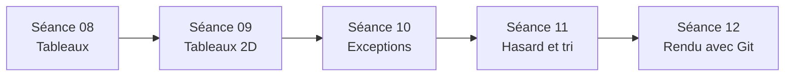

# Mini-projet - Code secret

V. Guidoux, avec l'aide de Claude.

Ce travail est sous licence [CC BY-SA 4.0][licence].

## Le principe

De la séance 08 à la séance 11, vous programmez un même jeu, pas à pas : **Code
secret**. Chaque séance apporte une notion, et une étape du jeu qui l'utilise.
En séance 12, vous rendez votre jeu terminé.

Le mini-projet est **guidé** : tout le monde programme le même jeu, en suivant
les mêmes étapes. Il n'y a pas de partie libre. Vous pouvez aller plus loin que
les étapes, mais rien ne l'exige.

## Le jeu

L'ordinateur choisit un code secret de quatre chiffres, chacun entre 1 et 6.
Vous avez dix essais pour le trouver. À chaque essai, vous proposez quatre
chiffres, et le jeu vous répond :

- combien de chiffres sont **bien placés** : le bon chiffre, à la bonne place ;
- combien sont **mal placés** : un chiffre du code, mais pas à cette place.

Avec le code secret `1 2 3 4`, la proposition `1 3 5 6` donne un chiffre bien
placé (le `1`) et un chiffre mal placé (le `3`).

C'est le principe d'un jeu traditionnel, connu en anglais sous le nom de _Bulls
and Cows_, et vendu dans le commerce sous d'autres noms.

## Les étapes

| Séance | Notion du jour             | Ce que le jeu sait faire à la fin de la séance                                  |
| -----: | :------------------------- | :------------------------------------------------------------------------------ |
|     08 | Tableaux                   | Comparer une proposition au code secret, compter les bien placés                |
|     09 | Tableaux à deux dimensions | Compter les mal placés, afficher l'historique des essais, découper en fonctions |
|     10 | Exceptions                 | Ne plus planter quand on tape `abc` ou un chiffre hors limites                  |
|     11 | Hasard et tri              | Tirer le code au hasard, garder un classement des parties                       |
|     12 | Git                        | Le jeu est rendu sur un dépôt                                                   |

Chaque étape est décrite sur la page de la séance, avec une solution possible
dans un bloc repliable. Si vous n'avez pas terminé une étape, terminez-la avant
la séance suivante : la suivante part de là.

## Les questionnaires

À la fin de chaque séance, de la 08 à la 11, vous recevez un questionnaire
papier, à remplir à la main et à rendre au début de la séance suivante. Il
compte pour 10% de la note de l'unité d'enseignement. Les détails sont sur la
page [Évaluation](01-evaluation.md#les-questionnaires-10).

## Le rendu, en séance 12

En séance 12, vous rendez votre jeu sur un dépôt Git, avec Classroom50. Le dépôt
contient au minimum :

- le code source, dans un fichier `Main.java` lisible ;
- un fichier `README.md` qui dit comment lancer le jeu, ce qui fonctionne et ce
  qui ne fonctionne pas encore, et quelles aides extérieures vous avez
  utilisées.

!!! note "Le lien vers Classroom50"

    Le lien et la procédure de rendu seront publiés sur la page de la séance
    12.

## Critères de qualité du code

Ce qui est regardé, dans cet ordre :

1. Le jeu fait ce que le `README.md` annonce.
2. Les noms de variables et de fonctions disent ce qu'ils contiennent ou font.
3. Le code est découpé en fonctions courtes, chacune avec une responsabilité.
4. Le code est indenté de manière cohérente.
5. Les commentaires expliquent pourquoi, pas ce que fait la ligne suivante.

Ce qui n'est pas regardé : l'élégance, la performance, le nombre de
fonctionnalités. Un petit jeu simple et compris vaut mieux qu'un gros jeu copié.

## Calendrier

<!-- URLs -->

[licence]:
	https://github.com/heig-vd-progim-course/heig-vd-progim1-course/blob/main/LICENSE.md
