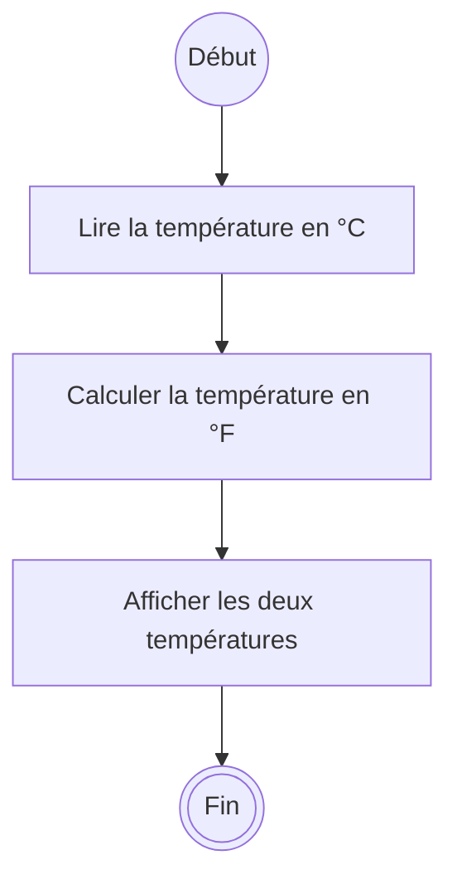

# Activité - Poser le problème

V. Guidoux, avec l'aide de Claude.

Ce travail est sous licence [CC BY-SA 4.0][licence].

## Objectif

Avant d'écrire une ligne de code, savoir dire ce que le programme reçoit, ce
qu'il en fait et ce qu'il rend. Et repérer ce que l'énoncé ne dit pas, parce que
le programme, lui, devra bien en faire quelque chose.

**Règle de l'activité : personne n'ouvre son ordinateur.**

## Trois colonnes

Tout programme que vous écrirez ce semestre peut se décrire en trois colonnes.

| Entrées                        | Traitement           | Sortie            |
| :----------------------------- | :------------------- | :---------------- |
| Ce que le programme **reçoit** | Ce qu'il **calcule** | Ce qu'il **rend** |

Un exemple, avant de vous laisser faire : convertir une température donnée en
degrés Celsius en degrés Fahrenheit.

| Entrées               | Traitement                          | Sortie                           |
| :-------------------- | :---------------------------------- | :------------------------------- |
| Une température en °C | `fahrenheit = celsius × 9 / 5 + 32` | La température en °F, au dixième |

Et le diagramme d'activité qui en découle :

Les trois colonnes deviennent trois actions, dans l'ordre. Ce n'est pas toujours
aussi direct, mais c'est le point de départ.

## Ce que l'énoncé ne dit pas

Un énoncé en français est toujours incomplet. Même celui de la température :

- La température peut-elle être négative ? Oui, et le calcul fonctionne.
- Combien de décimales à l'affichage ? L'énoncé dit _"au dixième"_ : c'est vous
  qui l'avez ajouté, et c'est une décision.
- Que se passe-t-il si quelqu'un tape _"vingt"_ ? L'énoncé ne le dit pas.

Ces questions n'ont pas toujours de réponse aujourd'hui. Ce qui compte, c'est de
les **écrire**. Une question non écrite devient un bogue que vous découvrirez
plus tard.

Quand vous ne pouvez pas trancher, notez une **hypothèse** : _"on suppose que la
personne tape un nombre"_. Une hypothèse écrite se vérifie et se remet en cause.
Une hypothèse implicite, non.

## À vous

Par groupes de trois ou quatre, sur papier. Pour chacun des trois problèmes :

1. remplissez les trois colonnes ;
2. listez au moins trois questions que l'énoncé laisse ouvertes ;
3. pour chacune, écrivez votre hypothèse.

### Problème 1 - La moyenne de deux notes

> Calculer la moyenne de deux notes et l'afficher.

C'est le fil rouge du semestre. Vous le reprendrez à chaque séance.

### Problème 2 - Le trajet à pied

> Dire combien de minutes il faut pour parcourir une distance à pied.

### Problème 3 - Le partage de l'addition

> Partager une addition de restaurant entre plusieurs personnes.

## Mise en commun

Chaque groupe vient écrire au tableau ses colonnes pour un des trois problèmes,
et ses questions ouvertes. Comparez avec les autres groupes :

- Avez-vous les mêmes entrées ? Si non, lesquelles sont justes ?
- Quelle question l'autre groupe a-t-il vue et pas vous ?
- Une question vous paraît-elle sans importance ? Défendez-le.

Vous verrez que deux groupes peuvent poser le même problème différemment, et
avoir raison tous les deux. Ce qui n'est pas acceptable, c'est une colonne floue
: _"des trucs"_ n'est pas une entrée.

<!-- URLs -->

[licence]:
	https://github.com/heig-vd-progim-course/heig-vd-progim1-course/blob/main/LICENSE.md
