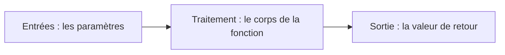

# Les fonctions et la portée des variables

V. Guidoux, avec l'aide de Claude.

Ce travail est sous licence [CC BY-SA 4.0][licence].

## Objectif

Découper un programme en morceaux qui ont un nom, qui reçoivent des valeurs et
qui en rendent une. Et savoir où une variable existe, et où elle n'existe pas.

!!! note "Comment lire les exemples de cette page"

    Chaque exemple montre le fichier `Main.java` **en entier**, avec ses
    numéros de ligne. Vous pouvez le copier tel quel dans IntelliJ et
    l'exécuter.

    Les lignes **surlignées** sont celles qui comptent dans l'exemple : celles
    qui ont été ajoutées ou modifiées, ou celle que désigne le message
    d'erreur. Quand un exemple transforme le précédent, deux onglets montrent
    le fichier _avant_ et _après_ : dans l'onglet _avant_, les lignes
    surlignées sont celles qui vont disparaître ou changer.

    Les numéros de ligne sont ceux que citent les messages d'erreur :
    `Main.java:9` désigne la ligne 9 du fichier affiché.

## Rappel : entrées, traitement, sortie

En séance 04, vous avez posé chaque problème en trois colonnes avant d'écrire le
code.

| Entrées                        | Traitement              | Sortie            |
| :----------------------------- | :---------------------- | :---------------- |
| Ce que le programme **reçoit** | Ce qu'il **calcule**    | Ce qu'il **rend** |
| Deux notes                     | `(grade1 + grade2) / 2` | La moyenne        |

Une fonction, c'est exactement ces trois colonnes, mais pour un **morceau** du
programme plutôt que pour le programme entier. Elle reçoit des valeurs, elle
calcule, elle rend un résultat.



Retenez cette correspondance. Tout le vocabulaire de cette page en découle.

## Vous utilisez déjà des fonctions

Relisez votre programme de la séance 04. Il en contient plusieurs.

```java title="Main.java" linenums="1" hl_lines="3-5"
public class Main {
    public static void main(String[] args) {
        double grade = Double.parseDouble("4.5");
        long rounded = Math.round(4.6);
        double root = Math.sqrt(16);
        System.out.println(grade);
        System.out.println(rounded);
        System.out.println(root);
    }
}
```

```text
4.5
5
4.0
```

| Appel                       | Ce qu'on lui donne | Ce qu'elle rend   |
| :-------------------------- | :----------------- | :---------------- |
| `Double.parseDouble("4.5")` | un `String`        | un `double` : 4.5 |
| `Math.round(4.6)`           | un nombre          | un entier : 5     |
| `Math.sqrt(16)`             | un nombre          | un `double` : 4.0 |
| `IO.readln("Note : ")`      | une question       | un `String`       |

Vous ne savez pas comment `Double.parseDouble` transforme un texte en nombre.
Vous n'en avez pas besoin : vous savez **ce qu'il faut lui donner** et **ce
qu'elle rend**. C'est tout l'intérêt d'une fonction.

Aujourd'hui, vous passez de l'autre côté : vous allez écrire les vôtres.

## Décortiquer l'arrondi au dixième

Le fil rouge arrondit la moyenne avec une ligne vue en séance 04 :

```java
double rounded = Math.round(average * 10) / 10.0;
```

Elle va servir d'exemple pendant toute la séance. Avant d'en faire une fonction,
prenons-la morceau par morceau.

### Ce que fait `Math.round`

`Math.round` est une fonction : on lui donne un nombre, elle rend **l'entier le
plus proche**. Quand le nombre tombe pile au milieu, elle arrondit vers le haut.

```java title="Main.java" linenums="1" hl_lines="3-5"
public class Main {
    public static void main(String[] args) {
        System.out.println(Math.round(4.4));
        System.out.println(Math.round(4.5));
        System.out.println(Math.round(4.6));
    }
}
```

```text
4
5
5
```

Deux choses à retenir :

- ce qu'elle rend est un **entier**, de type `long` : un `int` qui peut aller
  plus loin. Il n'a plus aucune décimale ;
- elle ne sait arrondir **qu'à l'unité**. Elle n'a pas d'option _"au dixième"_.

Or une moyenne de 4.75 doit devenir 4.8, pas 5. D'où l'astuce.

### L'astuce : déplacer la virgule

On ne peut arrondir qu'à l'unité ? Alors on **déplace la virgule** pour que les
dixièmes deviennent des unités, on arrondit, puis on remet la virgule à sa
place.

Trois étapes, avec deux valeurs : 4.75, la moyenne de Noah, et 4.32.

| Étape                          | Code              | Avec 4.75 | Avec 4.32 |
| :----------------------------- | :---------------- | --------: | --------: |
| 1. Décaler la virgule à droite | `average * 10`    |    `47.5` |    `43.2` |
| 2. Arrondir à l'entier         | `Math.round(...)` |      `48` |      `43` |
| 3. Remettre la virgule         | `... / 10.0`      |     `4.8` |     `4.3` |

- Étape 1 : multiplier par 10 déplace la virgule d'un rang. Le chiffre des
  dixièmes, 7 ou 3, devient le chiffre des unités.
- Étape 2 : `Math.round` arrondit à l'unité. Comme les dixièmes sont devenus des
  unités, c'est bien au dixième qu'on arrondit. 47.5 tombe au milieu, il monte
  à 48. 43.2 est plus près de 43.
- Étape 3 : diviser par 10 ramène la virgule à sa place.

Le même calcul, une étape par ligne, pour voir chaque valeur intermédiaire :

=== "Avec 4.75"

    ```java title="Main.java" linenums="1" hl_lines="5-7"
    public class Main {
        public static void main(String[] args) {
            double average = 4.75;

            double timesTen = average * 10;
            long roundedTimesTen = Math.round(timesTen);
            double rounded = roundedTimesTen / 10.0;

            System.out.println(timesTen);
            System.out.println(roundedTimesTen);
            System.out.println(rounded);
        }
    }
    ```

    ```text
    47.5
    48
    4.8
    ```

=== "Avec 4.32"

    ```java title="Main.java" linenums="1" hl_lines="3"
    public class Main {
        public static void main(String[] args) {
            double average = 4.32;

            double timesTen = average * 10;
            long roundedTimesTen = Math.round(timesTen);
            double rounded = roundedTimesTen / 10.0;

            System.out.println(timesTen);
            System.out.println(roundedTimesTen);
            System.out.println(rounded);
        }
    }
    ```

    ```text
    43.2
    43
    4.3
    ```

Seule la ligne 3 change entre les deux onglets. Les lignes 5 à 7 font les trois
étapes du tableau, dans l'ordre. `Math.round(average * 10) / 10.0` fait
exactement la même chose, en une ligne : Java calcule d'abord ce qui est entre
les parenthèses, puis l'appel, puis la division.

### Pourquoi `10.0` et pas `10`

À l'étape 3, `roundedTimesTen` est un `long`, un entier. Divisé par l'entier
`10`, c'est une **division entière**, le premier piège de la séance 03 :

```java title="Main.java" linenums="1" hl_lines="4 5"
public class Main {
    public static void main(String[] args) {
        long roundedTimesTen = Math.round(4.75 * 10);
        System.out.println(roundedTimesTen / 10.0);
        System.out.println(roundedTimesTen / 10);
    }
}
```

```text
4.8
4
```

Avec `10.0`, un nombre à virgule, la division garde les décimales. Avec `10`,
elle les jette : 48 / 10 donne 4. Gardez ce `4` en tête, vous allez le revoir
dans la section suivante.

??? note "Arrondir à autre chose qu'au dixième"

    Le principe est toujours le même : multiplier pour que la précision voulue
    devienne l'unité, arrondir, rediviser.

    - au centième : `Math.round(value * 100) / 100.0` ;
    - au demi-point, comme en séance 04 : `Math.round(value * 2) / 2.0` ;
    - aux 5 centimes : `Math.round(amount * 20) / 20.0`, puisqu'il y a 20 fois
      5 centimes dans un franc.

## Pourquoi écrire ses propres fonctions

Le fil rouge, pour trois personnes, avec ce que vous savez déjà :

```java title="Main.java" linenums="1" hl_lines="10"
public class Main {
    public static void main(String[] args) {
        double averageCamille = (3.3 + 4.6) / 2;
        double roundedCamille = Math.round(averageCamille * 10) / 10.0;

        double averageNoah = (5.5 + 4.0) / 2;
        double roundedNoah = Math.round(averageNoah * 10) / 10.0;

        double averageLou = (4.5 + 5.0) / 2;
        double roundedLou = Math.round(averageLou * 10) / 10;

        System.out.println("Camille : " + roundedCamille);
        System.out.println("Noah : " + roundedNoah);
        System.out.println("Lou : " + roundedLou);
    }
}
```

```text
Camille : 4.0
Noah : 4.8
Lou : 4.0
```

Noah et Lou ont la même moyenne exacte, 4.75. Le programme affiche 4.8 pour
l'une et 4.0 pour l'autre. La ligne 10 a été copiée, puis un `.0` s'est perdu :
`/ 10` au lieu de `/ 10.0`. C'est le `4` de la section précédente, rangé dans un
`double`, d'où `4.0`.

C'est le problème que vous avez déjà rencontré en séance 02 et en séance 03 :
**une même chose écrite à plusieurs endroits finit par ne plus être la même**.
La constante `final` réglait ce problème pour une valeur. La fonction le règle
pour un calcul.

## Écrire une première fonction

=== "Avant"

    ```java title="Main.java" linenums="1" hl_lines="4 7 10 12-14"
    public class Main {
        public static void main(String[] args) {
            double averageCamille = (3.3 + 4.6) / 2;
            double roundedCamille = Math.round(averageCamille * 10) / 10.0;

            double averageNoah = (5.5 + 4.0) / 2;
            double roundedNoah = Math.round(averageNoah * 10) / 10.0;

            double averageLou = (4.5 + 5.0) / 2;
            double roundedLou = Math.round(averageLou * 10) / 10;

            System.out.println("Camille : " + roundedCamille);
            System.out.println("Noah : " + roundedNoah);
            System.out.println("Lou : " + roundedLou);
        }
    }
    ```

=== "Après"

    ```java title="Main.java" linenums="1" hl_lines="2-5 12-14"
    public class Main {
        public static double roundToTenth(double value) {
            double rounded = Math.round(value * 10) / 10.0;
            return rounded;
        }

        public static void main(String[] args) {
            double averageCamille = (3.3 + 4.6) / 2;
            double averageNoah = (5.5 + 4.0) / 2;
            double averageLou = (4.5 + 5.0) / 2;

            System.out.println("Camille : " + roundToTenth(averageCamille));
            System.out.println("Noah : " + roundToTenth(averageNoah));
            System.out.println("Lou : " + roundToTenth(averageLou));
        }
    }
    ```

```text
Camille : 4.0
Noah : 4.8
Lou : 4.8
```

Ce qui a changé :

- les trois lignes `rounded...` ont **disparu** de `main` ;
- les lignes 2 à 5 sont **ajoutées** : c'est la fonction `roundToTenth` ;
- les lignes 12 à 14 sont **modifiées** : elles appellent la fonction.

Le calcul de l'arrondi n'est plus écrit qu'une fois. S'il est faux, il est faux
partout, et il se corrige à un seul endroit.

### Où l'écrire

Une fonction s'écrit **dans la classe** `Main`, **à côté** de `main`, jamais à
l'intérieur. `main` est elle-même une fonction : vous en écrivez une deuxième au
même niveau.

L'ordre n'a pas d'importance : `roundToTenth` peut être écrite avant ou après
`main`. Le programme commence toujours par `main`.

### Dans quel ordre le programme s'exécute

Le programme ne lit plus le fichier de haut en bas. Il suit les appels.

1. Java démarre `main`, à la ligne 8.
2. Il calcule les trois moyennes, lignes 8 à 10.
3. Ligne 12, il rencontre `roundToTenth(averageCamille)`. Il **met `main` en
   pause**, copie la valeur de `averageCamille` (3.9499999999999997) dans
   `value`, et saute à la ligne 3.
4. Ligne 4, `return rounded;` renvoie 4.0 à l'endroit de l'appel. `roundToTenth`
   est terminée, `main` reprend à la ligne 12.
5. L'appel `roundToTenth(averageCamille)` est remplacé par sa valeur, 4.0, et la
   ligne affiche `Camille : 4.0`.
6. Même chose aux lignes 13 et 14.

Une fonction qui n'est jamais appelée n'est jamais exécutée, comme une ligne
écrite en dehors de `main` en séance 03.

## Le vocabulaire

Reprenons le fichier précédent.

```java title="Main.java" linenums="1" hl_lines="2-5 12"
public class Main {
    public static double roundToTenth(double value) {
        double rounded = Math.round(value * 10) / 10.0;
        return rounded;
    }

    public static void main(String[] args) {
        double averageCamille = (3.3 + 4.6) / 2;
        double averageNoah = (5.5 + 4.0) / 2;
        double averageLou = (4.5 + 5.0) / 2;

        System.out.println("Camille : " + roundToTenth(averageCamille));
        System.out.println("Noah : " + roundToTenth(averageNoah));
        System.out.println("Lou : " + roundToTenth(averageLou));
    }
}
```

### Du côté de la déclaration : lignes 2 à 5

| Morceau           | Nom                  | Ce que c'est                                  |
| :---------------- | :------------------- | :-------------------------------------------- |
| `public static`   | modificateurs        | Le même cadre que `main`. Expliqué plus tard  |
| `double`          | type de retour       | Le type de la valeur que la fonction rend     |
| `roundToTenth`    | nom                  | Un verbe, en anglais, en camelCase            |
| `(double value)`  | liste des paramètres | Ce que la fonction reçoit : un type et un nom |
| lignes 3 et 4     | corps                | Le traitement, entre les accolades            |
| `return rounded;` | instruction `return` | Rend la valeur et termine la fonction         |

La ligne 2, jusqu'à l'accolade, s'appelle l'**en-tête** de la fonction.

### Du côté de l'appel : ligne 12

| Morceau                        | Nom              | Ce que c'est                                   |
| :----------------------------- | :--------------- | :--------------------------------------------- |
| `roundToTenth(averageCamille)` | appel            | L'instruction qui fait exécuter la fonction    |
| `averageCamille`               | argument         | La valeur donnée à la fonction lors de l'appel |
| ce que l'appel vaut            | valeur de retour | Ce qui remplace l'appel une fois terminé       |

### Paramètre ou argument

Les deux mots sont souvent confondus, y compris en ligne. Dans ce cours :

- le **paramètre** est la variable déclarée dans l'en-tête : `value`, ligne 2 ;
- l'**argument** est la valeur donnée au moment de l'appel : `averageCamille`,
  ligne 12.

À l'appel, la valeur de l'argument est **copiée** dans le paramètre.

### La signature

Au sens strict, en Java, la **signature** d'une fonction est son nom et la liste
des types de ses paramètres. Celle de `roundToTenth` est :

```text
roundToTenth(double)
```

Le type de retour, les modificateurs et les noms des paramètres n'en font pas
partie. C'est la définition de la documentation officielle de Java. Beaucoup de
tutoriels, dont celui d'OpenClassrooms, appellent _"signature"_ toute la
première ligne : sachez que les deux usages existent, et que ce cours suit la
définition officielle.

La signature dit ce qu'il faut savoir pour **appeler** la fonction : son nom, et
quoi lui donner, dans quel ordre.

### Fonction ou méthode

En Java, toute fonction est écrite dans une classe, et s'appelle donc
officiellement une **méthode**. Vous croiserez les deux mots. Dans ce cours, on
dit _"fonction"_ tant qu'on n'a pas besoin de la différence.

## Paramètres et arguments

### Les noms n'ont pas besoin de correspondre

L'argument `averageCamille` arrive dans le paramètre `value`. Les noms sont
différents, et c'est normal : la fonction ne connaît pas le nom de la variable
qui lui a été passée. Elle ne reçoit qu'une **valeur**.

Un argument n'est même pas forcément une variable. Ces trois appels sont valides
: `roundToTenth(4.75)`, `roundToTenth((grade1 + grade2) / 2)`,
`roundToTenth(Math.sqrt(17))`. Dans chaque cas, Java calcule d'abord la valeur
de l'argument, puis la copie dans `value`.

### L'ordre compte, les noms non

Une fonction peut avoir plusieurs paramètres, séparés par des virgules. Le
problème du trajet à pied de la séance 04 :

```java title="Main.java" linenums="1" hl_lines="2 7 8"
public class Main {
    public static double walkingMinutes(double distanceKm, double speedKmh) {
        return (distanceKm / speedKmh) * 60;
    }

    public static void main(String[] args) {
        System.out.println(walkingMinutes(10, 5));
        System.out.println(walkingMinutes(5, 10));
    }
}
```

```text
120.0
30.0
```

Dix kilomètres à 5 km/h, c'est 10 / 5 = 2 heures, soit 120 minutes. La ligne 8
calcule autre chose : cinq kilomètres à 10 km/h, une demi-heure. Le premier
argument va dans le premier paramètre, le deuxième dans le deuxième. **Java ne
regarde que la position**, jamais le nom. Inverser deux arguments du même type
compile, s'exécute, et donne un résultat faux.

D'où l'importance de noms de paramètres qui disent ce qu'ils contiennent, avec
l'unité si elle compte : `distanceKm`, pas `a`.

!!! tip "Une opération, deux opérandes"

    Remarquez les parenthèses de la ligne 3 : `(distanceKm / speedKmh) * 60`.
    Sans elles, Java donnerait le même résultat, parce qu'il calcule de gauche
    à droite. Mais il faudrait le savoir, et s'en souvenir.

    Règle de ce cours : **une opération porte sur deux valeurs**. Dès qu'un
    calcul en enchaîne plusieurs, des parenthèses disent dans quel ordre les
    faire. On lit alors le calcul comme on le ferait à la main : d'abord la
    durée en heures, ensuite la conversion en minutes.

### Le compilateur vérifie le type et le nombre

Un argument du mauvais type :

```java title="Main.java" linenums="1" hl_lines="7"
public class Main {
    public static double roundToTenth(double value) {
        return Math.round(value * 10) / 10.0;
    }

    public static void main(String[] args) {
        System.out.println(roundToTenth("Virginie"));
    }
}
```

```text
Main.java:7: error: incompatible types: String cannot be converted to double
        System.out.println(roundToTenth("Virginie"));
                                        ^
Note: Some messages have been simplified; recompile with -Xdiags:verbose to get full output
1 error
```

C'est le même message qu'en séance 04, quand on rangeait un `String` dans un
`double`. Ce n'est pas un hasard : passer un argument, c'est ranger une valeur
dans le paramètre.

Un argument en trop ou en moins :

```java title="Main.java" linenums="1" hl_lines="7"
public class Main {
    public static double walkingMinutes(double distanceKm, double speedKmh) {
        return (distanceKm / speedKmh) * 60;
    }

    public static void main(String[] args) {
        System.out.println(walkingMinutes(10));
    }
}
```

```text
Main.java:7: error: method walkingMinutes in class Main cannot be applied to given types;
        System.out.println(walkingMinutes(10));
                           ^
  required: double,double
  found:    int
  reason: actual and formal argument lists differ in length
1 error
```

`required` dit ce que la signature attend, `found` ce que vous avez donné. Les
_"formal arguments"_ sont les paramètres, les _"actual arguments"_ les
arguments.

## La valeur de retour

### `return` rend la valeur et termine la fonction

`return` fait deux choses : il renvoie une valeur à l'endroit de l'appel, et il
**termine** la fonction. Une ligne écrite après `return` ne serait jamais
exécutée, et le compilateur le refuse :

```java title="Main.java" linenums="1" hl_lines="4"
public class Main {
    public static double roundToTenth(double value) {
        return Math.round(value * 10) / 10.0;
        System.out.println("Fin de l'arrondi");
    }

    public static void main(String[] args) {
        System.out.println(roundToTenth(3.95));
    }
}
```

```text
Main.java:4: error: unreachable statement
        System.out.println("Fin de l'arrondi");
        ^
1 error
```

Remarquez aussi la ligne 3 : on peut rendre directement une expression, sans
passer par une variable. `return Math.round(value * 10) / 10.0;` fait la même
chose que les deux lignes de la première version.

### Oublier le `return`

```java title="Main.java" linenums="1" hl_lines="3 4"
public class Main {
    public static double roundToTenth(double value) {
        double rounded = Math.round(value * 10) / 10.0;
    }

    public static void main(String[] args) {
        System.out.println(roundToTenth(3.95));
    }
}
```

```text
Main.java:4: error: missing return statement
    }
    ^
1 error
```

L'en-tête promet un `double`. Le corps n'en rend aucun. Le compilateur pointe
l'accolade fermante de la ligne 4 : c'est là que la fonction se termine sans
avoir tenu sa promesse.

### Oublier d'utiliser la valeur rendue

Plus traître, parce que cela compile :

=== "Avant"

    ```java title="Main.java" linenums="1" hl_lines="8 9"
    public class Main {
        public static double roundToTenth(double value) {
            return Math.round(value * 10) / 10.0;
        }

        public static void main(String[] args) {
            double average = (3.3 + 4.6) / 2;
            roundToTenth(average);
            System.out.println("Moyenne : " + average);
        }
    }
    ```

    ```text
    Moyenne : 3.9499999999999997
    ```

=== "Après"

    ```java title="Main.java" linenums="1" hl_lines="8 9"
    public class Main {
        public static double roundToTenth(double value) {
            return Math.round(value * 10) / 10.0;
        }

        public static void main(String[] args) {
            double average = (3.3 + 4.6) / 2;
            double rounded = roundToTenth(average);
            System.out.println("Moyenne : " + rounded);
        }
    }
    ```

    ```text
    Moyenne : 4.0
    ```

Dans l'onglet _avant_, `roundToTenth` a bien calculé 4.0 et l'a rendu, ligne 8.
Personne ne l'a récupéré : la valeur est perdue. La fonction ne modifie **pas**
`average`. Dans l'onglet _après_, le résultat est rangé dans une variable, ligne
8, et c'est elle qu'on affiche, ligne 9.

### `void` : une fonction qui ne rend rien

Certaines fonctions font quelque chose sans rien rendre : afficher, par exemple.
Leur type de retour est `void`, _"vide"_. C'est le cas de `main`.

```java title="Main.java" linenums="1" hl_lines="2-4 7"
public class Main {
    public static void printAverage(String name, double average) {
        System.out.printf("%s a obtenu %.1f de moyenne.%n", name, average);
    }

    public static void main(String[] args) {
        printAverage("Camille", 4.75);
    }
}
```

```text
Camille a obtenu 4.8 de moyenne.
```

Une fonction `void` n'a pas de `return` suivi d'une valeur. Et son appel ne vaut
rien : on ne peut pas le ranger dans une variable.

```java title="Main.java" linenums="1" hl_lines="8"
public class Main {
    public static void printAverage(String name, double average) {
        System.out.printf("%s a obtenu %.1f de moyenne.%n", name, average);
    }

    public static void main(String[] args) {
        printAverage("Camille", 4.75);
        double result = printAverage("Noah", 4.8);
    }
}
```

```text
Main.java:8: error: incompatible types: void cannot be converted to double
        double result = printAverage("Noah", 4.8);
                                    ^
1 error
```

!!! warning "Afficher n'est pas rendre"

    `System.out.println` montre une valeur à la personne devant l'écran.
    `return` donne une valeur au programme, qui peut s'en servir pour continuer
    à calculer. Une fonction qui affiche sa moyenne au lieu de la rendre ne
    permet plus de l'arrondir, ni de la comparer à 4 en séance 06.

    Règle de ce cours : **une fonction de calcul rend son résultat, elle ne
    l'affiche pas**. L'affichage est le travail de `main`, ou d'une fonction
    `void` dont c'est le seul rôle.

## Une fonction peut en appeler une autre

```java title="Main.java" linenums="1" hl_lines="6-9 12"
public class Main {
    public static double roundToTenth(double value) {
        return Math.round(value * 10) / 10.0;
    }

    public static double computeAverage(double grade1, double grade2) {
        double average = (grade1 + grade2) / 2;
        return roundToTenth(average);
    }

    public static void main(String[] args) {
        double result = computeAverage(3.3, 4.6);
        System.out.println("Moyenne : " + result);
    }
}
```

```text
Moyenne : 4.0
```

`main` appelle `computeAverage`, qui appelle `roundToTenth`. Chacune attend que
celle qu'elle a appelée ait terminé :

1. ligne 12, `main` se met en pause et appelle `computeAverage(3.3, 4.6)` ;
2. ligne 7, `computeAverage` calcule 3.9499999999999997 ;
3. ligne 8, elle se met en pause à son tour et appelle `roundToTenth` ;
4. ligne 3, `roundToTenth` rend 4.0 à `computeAverage` ;
5. ligne 8, `computeAverage` rend 4.0 à `main` ;
6. ligne 12, `main` reprend, range 4.0 dans `result`, puis l'affiche ligne 13.

C'est ainsi qu'on construit un programme plus grand : des fonctions courtes, qui
en utilisent d'autres. `main` finit par ne plus faire que lire, appeler et
afficher.

## La portée des variables

### Commençons par l'erreur

Ce programme semble raisonnable. Il ne compile pas.

```java title="Main.java" linenums="1" hl_lines="3 9"
public class Main {
    public static double computeAverage(double grade1, double grade2) {
        double average = (grade1 + grade2) / 2;
        return average;
    }

    public static void main(String[] args) {
        computeAverage(4.5, 5.0);
        System.out.println(average);
    }
}
```

```text
Main.java:9: error: cannot find symbol
        System.out.println(average);
                           ^
  symbol:   variable average
  location: class Main
1 error
```

_"Cannot find symbol"_ : à la ligne 9, Java ne connaît aucune variable nommée
`average`. Elle existe pourtant, ligne 3.

Et dans l'autre sens :

```java title="Main.java" linenums="1" hl_lines="3 7"
public class Main {
    public static double computeAverage(double grade1, double grade2) {
        return (grade1 + grade2) / divisor;
    }

    public static void main(String[] args) {
        int divisor = 2;
        System.out.println(computeAverage(4.5, 5.0));
    }
}
```

```text
Main.java:3: error: cannot find symbol
        return (grade1 + grade2) / divisor;
                                   ^
  symbol:   variable divisor
  location: class Main
1 error
```

### La règle

Une variable n'existe qu'**entre sa déclaration et l'accolade fermante du bloc
dans lequel elle est déclarée**. Cette zone s'appelle sa **portée**.

- Dans le premier programme, `average` est déclarée ligne 3, dans
  `computeAverage` : elle n'existe que jusqu'à la ligne 5. `main` ne la voit
  pas.
- Dans le second, `divisor` est déclarée ligne 7, dans `main` : elle n'existe
  que là. `computeAverage` ne la voit pas.
- Un paramètre est une variable comme une autre, dont la portée est tout le
  corps de sa fonction.

Une variable déclarée dans une fonction s'appelle une **variable locale**. Elle
est créée à chaque appel, et elle disparaît quand la fonction se termine.

Pour faire sortir une valeur d'une fonction, il n'y a qu'un chemin : `return`.
Pour en faire entrer une, il n'y a qu'un chemin : un paramètre. Ce sont les
entrées et la sortie du début de cette page.

La correction du premier programme : récupérer la valeur rendue.

=== "Avant"

    ```java title="Main.java" linenums="1" hl_lines="8 9"
    public class Main {
        public static double computeAverage(double grade1, double grade2) {
            double average = (grade1 + grade2) / 2;
            return average;
        }

        public static void main(String[] args) {
            computeAverage(4.5, 5.0);
            System.out.println(average);
        }
    }
    ```

=== "Après"

    ```java title="Main.java" linenums="1" hl_lines="8"
    public class Main {
        public static double computeAverage(double grade1, double grade2) {
            double average = (grade1 + grade2) / 2;
            return average;
        }

        public static void main(String[] args) {
            double average = computeAverage(4.5, 5.0);
            System.out.println(average);
        }
    }
    ```

    ```text
    4.75
    ```

Il y a maintenant deux variables `average` : celle de la ligne 3 et celle de la
ligne 8. Ce ne sont pas les mêmes. La section suivante le montre.

### Le même nom, deux variables

Deux fonctions peuvent avoir chacune une variable du même nom. Ce sont deux
variables **différentes**, qui ne se voient pas.

```java title="Main.java" linenums="1" hl_lines="2 3 9"
public class Main {
    public static double addBonus(double grade) {
        grade = grade + 0.5;
        System.out.println("Dans addBonus, grade vaut " + grade);
        return grade;
    }

    public static void main(String[] args) {
        double grade = 4.0;
        double withBonus = addBonus(grade);
        System.out.println("Dans main, grade vaut " + grade);
        System.out.println("Dans main, withBonus vaut " + withBonus);
    }
}
```

```text
Dans addBonus, grade vaut 4.5
Dans main, grade vaut 4.0
Dans main, withBonus vaut 4.5
```

À l'appel, ligne 10, la **valeur** 4.0 est copiée dans le paramètre `grade` de
`addBonus`. La ligne 3 modifie cette copie. Le `grade` de `main`, déclaré ligne
9, n'a pas bougé.

Modifier un paramètre ne modifie jamais l'argument. Si vous voulez que `main`
récupère le changement, il faut le rendre et le ranger.

### Le même nom dans le même bloc

Dans une même fonction, en revanche, deux variables ne peuvent pas porter le
même nom. Un paramètre compte :

```java title="Main.java" linenums="1" hl_lines="2 3"
public class Main {
    public static double roundToTenth(double value) {
        double value = Math.round(value * 10) / 10.0;
        return value;
    }

    public static void main(String[] args) {
        System.out.println(roundToTenth(3.95));
    }
}
```

```text
Main.java:3: error: variable value is already defined in method roundToTenth(double)
        double value = Math.round(value * 10) / 10.0;
               ^
1 error
```

Notez que le message cite la signature : `roundToTenth(double)`.

??? note "Et une constante utilisée par plusieurs fonctions ?"

    Une constante déclarée avec `final` dans `main` suit la même règle : les
    autres fonctions ne la voient pas. Pour qu'une constante soit visible dans
    toute la classe, on la déclare **dans la classe, hors de toute fonction**,
    avec le même cadre `public static` :

    ```java title="Main.java" linenums="1" hl_lines="2 3 6 10"
    public class Main {
        public static final double EXAM_WEIGHT = 0.5;
        public static final double PROJECT_WEIGHT = 0.5;

        public static double computeFinalGrade(double exam, double project) {
            return (exam * EXAM_WEIGHT) + (project * PROJECT_WEIGHT);
        }

        public static void main(String[] args) {
            System.out.println("Poids de l'examen : " + EXAM_WEIGHT);
            System.out.println(computeFinalGrade(4.2, 5.5));
        }
    }
    ```

    ```text
    Poids de l'examen : 0.5
    4.85
    ```

    Réservez cela aux **constantes**. Une variable modifiable visible partout
    est la porte ouverte à _"qui a changé cette valeur ?"_ : on n'en écrit pas
    dans ce cours.

## Bien découper

Quelques règles, qui reprennent celles des diagrammes de la séance 01 :

- **Une fonction, une tâche.** Si vous devez écrire _"et"_ pour dire ce qu'elle
  fait, c'est probablement deux fonctions.
- **Un nom qui est un verbe** : `computeAverage`, `roundToTenth`,
  `printAverage`. C'est le verbe à l'infinitif de vos rectangles de diagramme,
  en anglais.
- **Une fonction de calcul ne lit pas au clavier et n'affiche rien.** Elle
  reçoit, elle calcule, elle rend. On peut alors la tester en l'appelant avec
  des valeurs écrites dans le code, sans rien taper.
- **Courte.** Une fonction qui ne tient pas à l'écran est trop longue.

Un rectangle de votre diagramme d'activité qui dit _"Calculer ..."_ est souvent
une fonction toute trouvée.

## Résumé

| Les trois colonnes | Dans une fonction             | Exemple                          |
| :----------------- | :---------------------------- | :------------------------------- |
| Entrées            | Les paramètres                | `(double grade1, double grade2)` |
| Traitement         | Le corps                      | les lignes entre les accolades   |
| Sortie             | La valeur rendue par `return` | `return average;`                |

- Une fonction se déclare dans la classe, à côté de `main`.
- On l'**appelle** en lui donnant des **arguments**, copiés dans ses
  **paramètres** dans l'ordre, quels que soient les noms.
- `return` rend une valeur et termine la fonction. Une fonction `void` ne rend
  rien.
- La **signature** est le nom et les types des paramètres :
  `roundToTenth(double)`.
- Une variable n'existe que dans le bloc où elle est déclarée. Ce qui entre
  passe par un paramètre, ce qui sort passe par `return`.
- `cannot find symbol` sur une variable qui existe ailleurs : regardez dans
  quelle fonction elle a été déclarée.

## Pour aller plus loin

- [Defining Methods](https://docs.oracle.com/javase/tutorial/java/javaOO/methods.html) -
  tutoriel officiel de Java, en anglais. La définition de la signature est là.
- [Passing Information to a Method](https://docs.oracle.com/javase/tutorial/java/javaOO/arguments.html) -
  paramètres, arguments et copie des valeurs.
- [Returning a Value from a Method](https://docs.oracle.com/javase/tutorial/java/javaOO/returnvalue.html) -
  `return` et `void`.
- [Exécutez des fonctions](https://openclassrooms.com/fr/courses/8383791-apprenez-a-programmer-en-java/8439602-executez-des-fonctions) -
  le chapitre correspondant d'OpenClassrooms, en français. Attention, il appelle
  _"signature"_ toute la première ligne.
- [Java Visualizer de Python Tutor](https://pythontutor.com/java.html) - collez
  un des fichiers de cette page et suivez pas à pas les appels et les variables
  de chaque fonction. Le meilleur moyen de _voir_ la portée. Il ne connaît pas
  `IO.readln` : utilisez-le sur des programmes sans saisie.

<!-- URLs -->

[licence]:
	https://github.com/heig-vd-progim-course/heig-vd-progim1-course/blob/main/LICENSE.md
