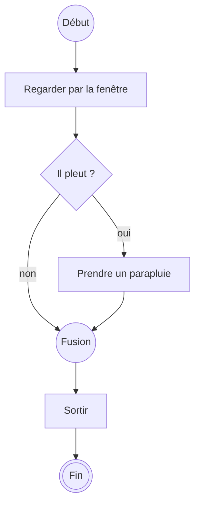
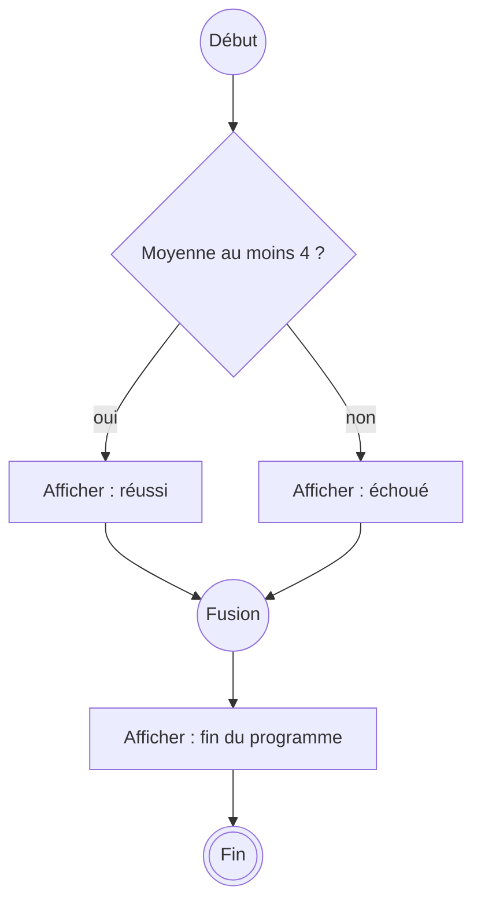

# Décider avec `if` et `else`

V. Guidoux, avec l'aide de Claude.

Ce travail est sous licence [CC BY-SA 4.0][licence].

## Objectif

Traduire en Java le losange des diagrammes d'activité : poser une question au
programme, et faire dépendre la suite de la réponse. À la fin de cette page,
certaines lignes de vos programmes ne s'exécuteront plus à chaque fois.

!!! note "Comment lire les exemples de cette page"

    Comme en séance 05, chaque exemple montre le fichier `Main.java` **en
    entier**, avec ses numéros de ligne. Les lignes **surlignées** sont celles
    qui comptent dans l'exemple, ou celle que désigne le message d'erreur.

    Les blocs **Quiz** sont des questions à choix multiple : cliquez sur une
    réponse. Répondez avant de lire la suite, c'est là qu'ils servent.

## Rappel : dans quel ordre ?

Avant d'aller plus loin, vérifions ce que vous avez retenu de la séance 05.

### Une fonction au-dessus de `main`

```java title="Main.java" linenums="1"
public class Main {
    public static void printMiddle() {
        System.out.println("2");
        System.out.println("3");
        System.out.println("4");
    }

    public static void main(String[] args) {
        System.out.println("1");
        printMiddle();
        System.out.println("5");
    }
}
```

<div class="quiz" markdown>

Qu'affiche ce programme, ligne après ligne ?

- [ ] `2 3 4 1 5`
- [x] `1 2 3 4 5`
- [ ] `1 5 2 3 4`
- [ ] `1 5`

<div class="quiz-explanation" markdown>

Un programme Java commence **toujours** par `main`, ligne 8, quelle que soit la
place de `main` dans le fichier. Ligne 9, il affiche `1`. Ligne 10, `main` se
met en pause et `printMiddle` affiche `2`, `3` et `4`. Puis `main` reprend
ligne 11 et affiche `5`.

Les lignes 3 à 5 sont écrites **avant** la ligne 9, mais elles s'exécutent
**après**. L'ordre d'exécution n'est pas l'ordre du fichier.

</div>

</div>

### Trois fonctions

Cette fois, les nombres sont écrits dans l'ordre du fichier.

```java title="Main.java" linenums="1"
public class Main {
    public static void printInner() {
        System.out.println("1");
    }

    public static void printOuter() {
        System.out.println("2");
        printInner();
        System.out.println("3");
    }

    public static void main(String[] args) {
        System.out.println("4");
        printOuter();
        System.out.println("5");
    }
}
```

<div class="quiz" markdown>

Qu'affiche ce programme, ligne après ligne ?

- [ ] `1 2 3 4 5`
- [ ] `4 1 2 3 5`
- [x] `4 2 1 3 5`
- [ ] `4 2 3 1 5`

<div class="quiz-explanation" markdown>

1. Ligne 13, `main` affiche `4`.
2. Ligne 14, `main` se met en pause et appelle `printOuter`.
3. Ligne 7, `printOuter` affiche `2`.
4. Ligne 8, `printOuter` se met en pause à son tour et appelle `printInner`,
   qui affiche `1` ligne 3.
5. Retour ligne 8, puis ligne 9 : `printOuter` affiche `3`.
6. Retour ligne 14, puis ligne 15 : `main` affiche `5`.

Chaque fonction attend que celle qu'elle a appelée ait terminé.

</div>

</div>

### Ce qui change aujourd'hui

Dans ces deux programmes, **chaque ligne s'exécute**, une fois, dans un ordre
que vous savez prévoir. C'est la **séquence** de la séance 01.

Aujourd'hui, une ligne pourra **ne pas s'exécuter du tout**, selon la valeur
d'une variable. C'est la **sélection** : le losange de vos diagrammes.

## Du losange au code

Le diagramme de la séance 01 pour sortir de chez soi :



Le même, en Java :

=== "Il pleut"

    ```java title="Main.java" linenums="1" hl_lines="3 6-8"
    public class Main {
        public static void main(String[] args) {
            boolean isRaining = true;

            System.out.println("Regarder par la fenêtre");
            if (isRaining) {
                System.out.println("Prendre un parapluie");
            }
            System.out.println("Sortir");
        }
    }
    ```

    ```text
    Regarder par la fenêtre
    Prendre un parapluie
    Sortir
    ```

=== "Il ne pleut pas"

    ```java title="Main.java" linenums="1" hl_lines="3 6-8"
    public class Main {
        public static void main(String[] args) {
            boolean isRaining = false;

            System.out.println("Regarder par la fenêtre");
            if (isRaining) {
                System.out.println("Prendre un parapluie");
            }
            System.out.println("Sortir");
        }
    }
    ```

    ```text
    Regarder par la fenêtre
    Sortir
    ```

Seule la ligne 3 change entre les deux onglets. Quand `isRaining` vaut `false`,
la ligne 7 est sautée : Java passe directement à la ligne 9, le nœud de fusion
du diagramme.

| Dans le diagramme     | En Java                                  |
| :-------------------- | :--------------------------------------- |
| Le losange            | `if`                                     |
| La question           | La **condition**, entre parenthèses      |
| Le chemin `[oui]`     | Le **bloc** entre accolades              |
| Le nœud de fusion     | L'accolade fermante : la suite reprend   |

La condition d'un `if` ne peut valoir que `true` ou `false`. C'est un
`boolean`, le type vu en séance 03.

## Une condition vaut `true` ou `false`

### Comparer deux valeurs

On obtient rarement un `boolean` en l'écrivant. On l'obtient en **comparant**.

| Opérateur | Se lit                   | Exemple       | Vaut    |
| :-------: | :----------------------- | :------------ | :------ |
|   `==`    | est égal à               | `4.5 == 4.5`  | `true`  |
|   `!=`    | est différent de         | `4.5 != 4.5`  | `false` |
|    `<`    | est plus petit que       | `3.5 < 4`     | `true`  |
|   `<=`    | est plus petit ou égal à | `4 <= 4`      | `true`  |
|    `>`    | est plus grand que       | `3.5 > 4`     | `false` |
|   `>=`    | est plus grand ou égal à | `4 >= 4`      | `true`  |

Une comparaison est une expression comme une autre : Java remplace les
variables par leur valeur, puis calcule. Simplement, le résultat n'est pas un
nombre, c'est `true` ou `false`.

```java title="Main.java" linenums="1" hl_lines="4-7"
public class Main {
    public static void main(String[] args) {
        double average = 4.5;
        System.out.println(average >= 4);
        System.out.println(average < 4);
        System.out.println(average == 4.5);
        System.out.println(average != 4.5);
    }
}
```

```text
true
false
true
false
```

<div class="quiz" markdown>

`average` vaut 4. Que vaut `average > 4` ?

- [ ] `true`, puisque 4 est la note suffisante
- [x] `false`
- [ ] `4`
- [ ] Une erreur de compilation

<div class="quiz-explanation" markdown>

`>` est **strictement** plus grand : 4 n'est pas plus grand que 4. Pour
inclure la limite, il faut `>=`. Cette différence d'un caractère est l'erreur
la plus fréquente de la séance : une note de 4 déclarée insuffisante.

</div>

</div>

### Ranger le résultat dans un `boolean`

Le résultat d'une comparaison se range dans une variable, comme celui d'un
calcul.

```java title="Main.java" linenums="1" hl_lines="4"
public class Main {
    public static void main(String[] args) {
        double average = 3.5;
        boolean passed = average >= 4;
        System.out.println(passed);
    }
}
```

```text
false
```

Ligne 4 : `average >= 4`, puis `3.5 >= 4`, puis `false`, rangé dans `passed`.

### `=` range, `==` compare

Un seul `=` **range** une valeur dans une variable. Deux `==` **comparent**
deux valeurs. Les confondre est une erreur que tout le monde fait.

```java title="Main.java" linenums="1" hl_lines="5"
public class Main {
    public static void main(String[] args) {
        double average = 4.0;

        if (average = 4) {
            System.out.println("Pile la moyenne");
        }
    }
}
```

```text
Main.java:5: error: incompatible types: double cannot be converted to boolean
        if (average = 4) {
                    ^
1 error
```

Le message se lit ainsi : `average = 4` range 4 dans `average`, et le résultat
de cette opération est un `double`. Or un `if` attend un `boolean`. La
correction : `if (average == 4)`.

## `if` et `else`

Le diagramme d'une note : si la moyenne atteint 4, c'est réussi, **sinon** c'est
échoué. Deux chemins, et un seul est emprunté.



```java title="Main.java" linenums="1" hl_lines="5-9"
public class Main {
    public static void main(String[] args) {
        double average = 3.5;

        if (average >= 4) {
            System.out.println("Réussi");
        } else {
            System.out.println("Échoué");
        }
        System.out.println("Fin du programme");
    }
}
```

```text
Échoué
Fin du programme
```

- Ligne 5, la condition vaut `false`. La ligne 6 est sautée.
- Le bloc du `else`, ligne 8, est exécuté.
- Ligne 10, le programme reprend, quel que soit le chemin pris.

**Exactement un** des deux blocs s'exécute : jamais les deux, jamais aucun. Un
`else` n'a pas de condition : c'est _"dans tous les autres cas"_.

!!! warning "Toujours des accolades"

    Java accepte un `if` sans accolades quand le bloc ne contient qu'une ligne.
    Ne le faites pas. Le jour où vous ajoutez une deuxième ligne, elle sera
    exécutée dans tous les cas, sans que rien ne vous prévienne. Dans ce cours,
    un `if` et un `else` ont toujours leurs accolades.

!!! warning "Pas de point-virgule après la condition"

    `if (average >= 4);` compile. Le point-virgule termine le `if` : il ne
    contrôle plus rien, et le bloc qui suit s'exécute toujours. C'est l'un des
    bugs de l'atelier.

## Une fonction qui répond par oui ou par non

En séance 05, la règle était : _une fonction de calcul rend son résultat, elle
ne l'affiche pas_. Une décision est un calcul comme un autre. Une fonction
peut donc rendre un `boolean`.

Première version, telle qu'on l'écrit spontanément :

=== "Avant"

    ```java title="Main.java" linenums="1" hl_lines="3-7"
    public class Main {
        public static boolean hasPassed(double average) {
            if (average >= 4) {
                return true;
            } else {
                return false;
            }
        }

        public static void main(String[] args) {
            System.out.println(hasPassed(4.5));
            System.out.println(hasPassed(3.5));
        }
    }
    ```

=== "Après"

    ```java title="Main.java" linenums="1" hl_lines="3"
    public class Main {
        public static boolean hasPassed(double average) {
            return average >= 4;
        }

        public static void main(String[] args) {
            System.out.println(hasPassed(4.5));
            System.out.println(hasPassed(3.5));
        }
    }
    ```

```text
true
false
```

Les deux versions affichent la même chose. Dans la première, quand
`average >= 4` vaut `true`, on rend `true` ; quand elle vaut `false`, on rend
`false`. Autrement dit, on rend la valeur de la comparaison. La seconde le dit
directement : les cinq lignes du `if` sont remplacées par une seule.

Le nom de la fonction pose une question à laquelle on répond par oui ou non :
`hasPassed`, _"a réussi ?"_. Les noms en `is`, `has` ou `can` sont la
convention pour les fonctions qui rendent un `boolean`.

On l'utilise ensuite directement comme condition :

```java title="Main.java" linenums="1" hl_lines="9"
public class Main {
    public static boolean hasPassed(double average) {
        return average >= 4;
    }

    public static void main(String[] args) {
        double average = 4.5;

        if (hasPassed(average)) {
            System.out.println("Réussi");
        } else {
            System.out.println("Échoué");
        }
    }
}
```

```text
Réussi
```

Ligne 9, l'appel est remplacé par ce qu'il rend, `true`, et le `if` décide.
Écrire `if (hasPassed(average) == true)` fonctionne aussi, mais n'ajoute rien :
`hasPassed(average)` vaut déjà `true` ou `false`.

<div class="quiz" markdown>

Laquelle de ces fonctions est la plus simple **et** correcte ?

- [ ] `return average > 4;`
- [ ] `if (average >= 4) { return true; }`
- [x] `return average >= 4;`
- [ ] `if (average >= 4 == true) { return true; } else { return false; }`

<div class="quiz-explanation" markdown>

`return average >= 4;` rend directement la valeur de la comparaison.
`average > 4` refuse la note 4. La deuxième ne compile pas : quand la condition
est fausse, la fonction n'a rien à rendre (`missing return statement`, vous le
verrez dans l'atelier). La dernière est correcte, mais fait en cinq lignes ce
qu'une seule fait.

</div>

</div>

## Une variable déclarée dans un bloc

La règle de portée de la séance 05 s'applique aussi ici : une variable existe
de sa déclaration à l'**accolade fermante de son bloc**. Le bloc d'un `if` est
un bloc comme un autre.

```java title="Main.java" linenums="1" hl_lines="6 8 10"
public class Main {
    public static void main(String[] args) {
        double average = 4.5;

        if (average >= 4) {
            String verdict = "réussi";
        } else {
            String verdict = "échoué";
        }
        System.out.println("Verdict : " + verdict);
    }
}
```

```text
Main.java:10: error: cannot find symbol
        System.out.println("Verdict : " + verdict);
                                          ^
  symbol:   variable verdict
  location: class Main
1 error
```

Il y a deux variables `verdict`, une par bloc, et chacune disparaît à son
accolade fermante. Ligne 10, aucune n'existe plus.

La correction : déclarer la variable **avant** le `if`, et lui donner une
valeur dans chaque bloc.

```java title="Main.java" linenums="1" hl_lines="4 7 9"
public class Main {
    public static void main(String[] args) {
        double average = 4.5;
        String verdict;

        if (average >= 4) {
            verdict = "réussi";
        } else {
            verdict = "échoué";
        }
        System.out.println("Verdict : " + verdict);
    }
}
```

```text
Verdict : réussi
```

Et si l'un des chemins ne lui donne pas de valeur, le compilateur le voit :

```java title="Main.java" linenums="1" hl_lines="9"
public class Main {
    public static void main(String[] args) {
        double average = 4.5;
        String verdict;

        if (average >= 4) {
            verdict = "réussi";
        }
        System.out.println("Verdict : " + verdict);
    }
}
```

```text
Main.java:9: error: variable verdict might not have been initialized
        System.out.println("Verdict : " + verdict);
                                          ^
1 error
```

Ici, `average` vaut 4.5 et le `if` est pris. Mais le compilateur ne regarde pas
les valeurs : il voit qu'il **existe** un chemin, celui où la condition est
fausse, sur lequel `verdict` n'a rien reçu. Il refuse.

## Résumé

| Diagramme d'activité  | Java                                       |
| :-------------------- | :----------------------------------------- |
| Losange               | `if (condition) { ... }`                   |
| Chemin `[oui]`        | Le bloc du `if`                            |
| Chemin `[non]`        | Le bloc du `else`                          |
| Nœud de fusion        | La ligne qui suit l'accolade fermante      |

- Une condition est un `boolean` : `true` ou `false`.
- On l'obtient en comparant : `==`, `!=`, `<`, `<=`, `>`, `>=`.
- `=` range, `==` compare.
- Avec `if` et `else`, exactement un des deux blocs s'exécute.
- Une fonction peut rendre un `boolean`. Son nom pose une question :
  `hasPassed`, `isValid`, `canVote`. Elle rend directement la comparaison :
  `return average >= 4;`.
- Une variable déclarée dans un bloc n'existe pas après son accolade fermante.

## Pour aller plus loin

- [Manipulez vos données](https://openclassrooms.com/fr/courses/8383791-apprenez-a-programmer-en-java/8439941-manipulez-vos-donnees) -
  le chapitre correspondant d'OpenClassrooms, en français, section _Vérifiez une
  condition_. Il compare aussi des `String` avec `equals`, qui sera vu en
  séance 09.
- [The if-then and if-then-else Statements](https://docs.oracle.com/javase/tutorial/java/nutsandbolts/if.html) -
  tutoriel officiel de Java, en anglais.
- [Equality, Relational, and Conditional Operators](https://docs.oracle.com/javase/tutorial/java/nutsandbolts/op2.html) -
  les opérateurs de comparaison, même tutoriel.
- [Java Visualizer de Python Tutor](https://pythontutor.com/java.html) - collez
  un des programmes de cette page et regardez quelle ligne est sautée.

<!-- URLs -->

[licence]:
	https://github.com/heig-vd-progim-course/heig-vd-progim1-course/blob/main/LICENSE.md
