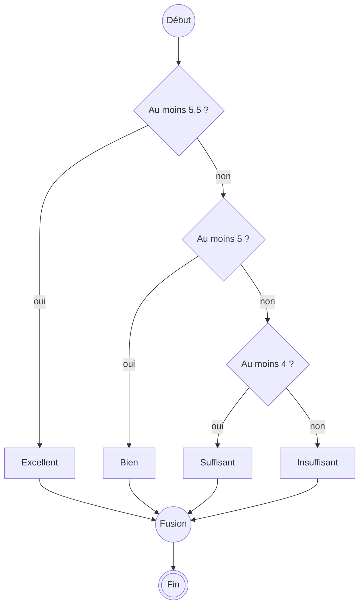

# Plusieurs cas et opérateurs logiques

V. Guidoux, avec l'aide de Claude.

Ce travail est sous licence [CC BY-SA 4.0][licence].

## Objectif

Choisir entre plus de deux chemins, et poser des questions composées : _"entre
1 et 6"_, _"samedi ou dimanche"_. Puis vérifier qu'une suite de conditions
couvre bien **tous** les cas, limites comprises.

## Plus de deux chemins : `else if`

Une moyenne n'est pas seulement réussie ou échouée. On veut une appréciation :

| Moyenne         | Appréciation |
| :-------------- | :----------- |
| 5.5 ou plus     | Excellent    |
| de 5 à 5.4      | Bien         |
| de 4 à 4.9      | Suffisant    |
| moins de 4      | Insuffisant  |

Dans un diagramme d'activité, ce sont plusieurs losanges à la suite : chaque
_"non"_ mène à la question suivante.



En Java, chaque _"non"_ suivi d'une question devient un `else if` :

```java title="Main.java" linenums="1" hl_lines="3-11"
public class Main {
    public static String describe(double average) {
        if (average >= 5.5) {
            return "Excellent";
        } else if (average >= 5) {
            return "Bien";
        } else if (average >= 4) {
            return "Suffisant";
        } else {
            return "Insuffisant";
        }
    }

    public static void main(String[] args) {
        System.out.println(describe(6));
        System.out.println(describe(5.2));
        System.out.println(describe(4));
        System.out.println(describe(3.5));
    }
}
```

```text
Excellent
Bien
Suffisant
Insuffisant
```

Java teste les conditions **de haut en bas**, et s'arrête à la **première**
qui vaut `true`. Pour `describe(5.2)` : ligne 3, `5.2 >= 5.5` est faux ; ligne
5, `5.2 >= 5` est vrai. On rend `"Bien"`, et la ligne 7 n'est même pas lue.

C'est pour cela que la ligne 5 n'a pas besoin de dire _"au moins 5 **et** moins
de 5.5"_ : si on y arrive, c'est que la ligne 3 a déjà répondu non.

Le `else` final attrape tout le reste. Il n'a pas de condition.

### L'ordre des conditions compte

<div class="quiz" markdown>

On inverse l'ordre des conditions :

```java
if (average >= 4) {
    return "Suffisant";
} else if (average >= 5) {
    return "Bien";
} else if (average >= 5.5) {
    return "Excellent";
} else {
    return "Insuffisant";
}
```

Que rend `describe(6)` ?

- [ ] `"Excellent"`, puisque 6 est au moins 5.5
- [ ] `"Bien"`
- [x] `"Suffisant"`
- [ ] Une erreur de compilation

<div class="quiz-explanation" markdown>

`6 >= 4` est vrai dès la première condition : on rend `"Suffisant"` et on
s'arrête. Les lignes `Bien` et `Excellent` ne sont **jamais** atteintes, pour
aucune note. Le programme compile et ne signale rien.

Avec des `>=`, on teste du plus grand au plus petit. Avec des `<`, du plus
petit au plus grand.

</div>

</div>

### `else if` ou deux `if` ?

Deux `if` à la suite sont deux questions **indépendantes** : les deux peuvent
être vraies, et les deux blocs s'exécutent. Un `else if` n'est posé que si la
question précédente a répondu non.

=== "Deux if"

    ```java title="Main.java" linenums="1" hl_lines="5-10"
    public class Main {
        public static void main(String[] args) {
            double average = 5.5;

            if (average >= 5) {
                System.out.println("Bien");
            }
            if (average >= 4) {
                System.out.println("Suffisant");
            }
        }
    }
    ```

    ```text
    Bien
    Suffisant
    ```

=== "if et else if"

    ```java title="Main.java" linenums="1" hl_lines="7"
    public class Main {
        public static void main(String[] args) {
            double average = 5.5;

            if (average >= 5) {
                System.out.println("Bien");
            } else if (average >= 4) {
                System.out.println("Suffisant");
            }
        }
    }
    ```

    ```text
    Bien
    ```

La seule différence : l'accolade de la ligne 7 et le `if` de la ligne 8 sont
réunis en `} else if`, ligne 7 du second onglet. Avec deux `if`, 5.5 est à la
fois _"Bien"_ et _"Suffisant"_. Si les cas s'excluent, c'est un `else if`.

## Combiner des conditions

### `&&` : et

Une note suisse est valable si elle est **entre 1 et 6** : au moins 1, **et**
au plus 6. Deux conditions, qui doivent être vraies toutes les deux.

```java title="Main.java" linenums="1" hl_lines="3"
public class Main {
    public static boolean isValidGrade(double grade) {
        return (grade >= 1) && (grade <= 6);
    }

    public static void main(String[] args) {
        System.out.println(isValidGrade(0.5));
        System.out.println(isValidGrade(1));
        System.out.println(isValidGrade(4.5));
        System.out.println(isValidGrade(6));
        System.out.println(isValidGrade(6.5));
    }
}
```

```text
false
true
true
true
false
```

Cinq tests : un en dessous, les deux limites, un au milieu, un au-dessus. C'est
la règle de l'atelier, appliquée à un intervalle.

### Pas de `1 <= grade <= 6`

En mathématiques, on écrit _1 ≤ note ≤ 6_. En Java, non :

```java title="Main.java" linenums="1" hl_lines="3"
public class Main {
    public static boolean isValidGrade(double grade) {
        return 1 <= grade <= 6;
    }

    public static void main(String[] args) {
        System.out.println(isValidGrade(4.5));
    }
}
```

```text
Main.java:3: error: bad operand types for binary operator '<='
        return 1 <= grade <= 6;
                          ^
  first type:  boolean
  second type: int
1 error
```

Java calcule d'abord `1 <= grade`, qui donne un `boolean`. Puis il essaie de
calculer `true <= 6`, ce qui n'a pas de sens : _"first type: boolean, second
type: int"_. Un opérateur, deux opérandes : il faut deux comparaisons, reliées
par `&&`.

### `||` : ou

L'inverse : une note est **hors limites** si elle est plus petite que 1, **ou**
plus grande que 6. Il suffit qu'une des deux conditions soit vraie.

```java title="Main.java" linenums="1" hl_lines="3"
public class Main {
    public static boolean isOutOfRange(double grade) {
        return (grade < 1) || (grade > 6);
    }

    public static void main(String[] args) {
        System.out.println(isOutOfRange(0.5));
        System.out.println(isOutOfRange(4.5));
        System.out.println(isOutOfRange(6.5));
    }
}
```

```text
true
false
true
```

Attention : le _"ou"_ de Java est **inclusif**. `a || b` vaut `true` si `a` est
vrai, si `b` est vrai, ou si les deux le sont. Ce n'est pas le _"fromage ou
dessert"_ du menu, où il faut choisir.

### `!` : non

`!` inverse une condition : `!true` vaut `false`, `!false` vaut `true`. Il se
place **devant** ce qu'il inverse.

```java title="Main.java" linenums="1" hl_lines="9"
public class Main {
    public static boolean isValidGrade(double grade) {
        return (grade >= 1) && (grade <= 6);
    }

    public static void main(String[] args) {
        double grade = 7;

        if (!isValidGrade(grade)) {
            System.out.println("Note invalide : " + grade);
        }
    }
}
```

```text
Note invalide : 7.0
```

Ligne 9 se lit _"si la note n'est pas valable"_. Plutôt que d'écrire une
deuxième fonction `isOutOfRange`, on inverse celle qu'on a déjà.

### En résumé : les tables de vérité

| `a`     | `b`     | `a && b` | `a \|\| b` | `!a`    |
| :------ | :------ | :------- | :--------- | :------ |
| `true`  | `true`  | `true`   | `true`     | `false` |
| `true`  | `false` | `false`  | `true`     | `false` |
| `false` | `true`  | `false`  | `true`     | `true`  |
| `false` | `false` | `false`  | `false`    | `true`  |

- `&&` ne vaut `true` que si **les deux** sont vrais.
- `||` ne vaut `false` que si **les deux** sont faux.

!!! note "Des parenthèses autour de chaque comparaison"

    Depuis la séance 05, la règle du cours est _une opération, deux opérandes_ :
    des parenthèses fixent l'ordre dès qu'une expression enchaîne plus d'un
    opérateur. Elle vaut aussi ici : `(grade >= 1) && (grade <= 6)`.

    Java saurait s'en passer, mais la personne qui relit, non. Et dès que `&&`
    et `||` se mélangent, l'oubli d'une parenthèse change le résultat sans
    erreur de compilation.

<div class="quiz" markdown>

Quelle condition est vraie quand `grade` est entre 1 et 6, limites comprises,
et seulement dans ce cas ?

- [ ] `1 <= grade <= 6`
- [ ] `(grade >= 1) || (grade <= 6)`
- [x] `(grade >= 1) && (grade <= 6)`
- [ ] `(grade > 1) && (grade < 6)`

<div class="quiz-explanation" markdown>

- `1 <= grade <= 6` ne compile pas.
- `(grade >= 1) || (grade <= 6)` est **toujours** vrai : tout nombre est soit
  au moins 1, soit au plus 6. Même 7, même -2. C'est un des bugs de l'atelier.
- `(grade > 1) && (grade < 6)` exclut les limites : un 6 serait refusé.

</div>

</div>

??? note "Pour aller plus loin : `&&` s'arrête dès qu'il connaît la réponse"

    Si la partie gauche d'un `&&` est fausse, le tout est faux, quelle que soit
    la partie droite. Java ne la calcule donc **pas**. De même, si la partie
    gauche d'un `||` est vraie, la droite n'est pas calculée.

    Cela sert à se protéger. Ici, `count` vaut 0, et une division entière par
    zéro arrête le programme :

    === "Le test d'abord"

        ```java title="Main.java" linenums="1" hl_lines="6"
        public class Main {
            public static void main(String[] args) {
                int total = 18;
                int count = 0;

                if ((count != 0) && ((total / count) >= 4)) {
                    System.out.println("Moyenne suffisante");
                } else {
                    System.out.println("Pas de moyenne");
                }
            }
        }
        ```

        ```text
        Pas de moyenne
        ```

    === "La division d'abord"

        ```java title="Main.java" linenums="1" hl_lines="6"
        public class Main {
            public static void main(String[] args) {
                int total = 18;
                int count = 0;

                if (((total / count) >= 4) && (count != 0)) {
                    System.out.println("Moyenne suffisante");
                } else {
                    System.out.println("Pas de moyenne");
                }
            }
        }
        ```

        ```text
        Exception in thread "main" java.lang.ArithmeticException: / by zero
        	at Main.main(Main.java:6)
        ```

    Mêmes deux conditions, dans l'autre ordre. Dans le premier onglet,
    `count != 0` est faux : Java ne calcule jamais `total / count`.

## Des conditions dans des conditions

Un bloc de `if` peut contenir n'importe quelle instruction, y compris un autre
`if`. C'est utile quand une question n'a de sens que si la précédente a
répondu oui : on ne se demande si la note est suffisante que si elle est
valable.

```java title="Main.java" linenums="1" hl_lines="13-21"
public class Main {
    public static boolean isValidGrade(double grade) {
        return (grade >= 1) && (grade <= 6);
    }

    public static boolean hasPassed(double average) {
        return average >= 4;
    }

    public static void main(String[] args) {
        double grade = 3.5;

        if (isValidGrade(grade)) {
            if (hasPassed(grade)) {
                System.out.println("Réussi");
            } else {
                System.out.println("Échoué");
            }
        } else {
            System.out.println("Note invalide");
        }
    }
}
```

```text
Échoué
```

Le `else` de la ligne 16 répond au `if` de la ligne 14, celui du même niveau
d'indentation. Celui de la ligne 19 répond à la ligne 13. IntelliJ indente pour
vous : si l'indentation ne correspond pas à ce que vous pensez, c'est votre
lecture qui est fausse, pas IntelliJ.

Au-delà de deux niveaux, le code devient difficile à lire. C'est souvent le
signe qu'une partie doit devenir une fonction.

## Ne comparez pas deux `double` avec `==`

Vous connaissez ce nombre depuis la séance 05 :

```java title="Main.java" linenums="1" hl_lines="9"
public class Main {
    public static double computeAverage(double grade1, double grade2) {
        return (grade1 + grade2) / 2;
    }

    public static void main(String[] args) {
        double average = computeAverage(3.3, 4.6);
        System.out.println(average);
        System.out.println(average == 3.95);
    }
}
```

```text
3.9499999999999997
false
```

Un `double` est une approximation. Deux calculs qui devraient donner la même
chose en mathématiques peuvent différer au dernier chiffre, et `==` compare
**tous** les chiffres. Même chose pour un calcul plus simple :

```java title="Main.java" linenums="1" hl_lines="3-4"
public class Main {
    public static void main(String[] args) {
        System.out.println(0.1 + 0.2);
        System.out.println((0.1 + 0.2) == 0.3);
    }
}
```

```text
0.30000000000000004
false
```

Avec des `double`, préférez `<`, `<=`, `>`, `>=`, et décidez sur une valeur
arrondie. C'est ce qui sauve Camille :

```java title="Main.java" linenums="1" hl_lines="18-19"
public class Main {
    public static double computeAverage(double grade1, double grade2) {
        return (grade1 + grade2) / 2;
    }

    public static double roundToTenth(double value) {
        return Math.round(value * 10) / 10.0;
    }

    public static boolean hasPassed(double average) {
        return average >= 4;
    }

    public static void main(String[] args) {
        double average = computeAverage(3.3, 4.6);
        double rounded = roundToTenth(average);

        System.out.println(average + " " + hasPassed(average));
        System.out.println(rounded + " " + hasPassed(rounded));
    }
}
```

```text
3.9499999999999997 false
4.0 true
```

Sur la moyenne exacte, Camille échoue, pour une différence de
0.0000000000000003. Sur la moyenne arrondie, celle qu'on affiche, elle réussit. Le programme doit
décider sur la valeur qu'il montre.

Les `int`, eux, sont exacts : `count == 0` ou `day == 6` ne posent aucun
problème.

## Couvrir tous les cas

Une suite de conditions est juste si **chaque** valeur possible tombe dans le
bon cas. Avant d'écrire la suite de `if`, écrivez le tableau des cas, et pour
chaque frontière, une valeur de chaque côté.

Pour `describe` :

| Valeur testée | Pourquoi                  | Attendu     |
| ------------: | :------------------------ | :---------- |
|             6 | le maximum                | Excellent   |
|           5.5 | limite basse d'Excellent  | Excellent   |
|           5.4 | juste en dessous          | Bien        |
|             5 | limite basse de Bien      | Bien        |
|           4.9 | juste en dessous          | Suffisant   |
|             4 | limite basse de Suffisant | Suffisant   |
|           3.9 | juste en dessous          | Insuffisant |
|             1 | le minimum                | Insuffisant |

Huit tests pour quatre cas. C'est beaucoup, et c'est le prix : chaque frontière
est un endroit où un `>` à la place d'un `>=` passe inaperçu.

Et les valeurs hors du tableau ? `describe(7)` rend `"Excellent"`. Ce n'est pas
à `describe` de vérifier la note : c'est le rôle d'`isValidGrade`, appelée
avant.

## Résumé

- `if`, `else if`, `else` : les conditions sont testées de haut en bas, et
  **seule la première vraie** est exécutée. L'ordre compte.
- Deux `if` à la suite sont indépendants : les deux blocs peuvent s'exécuter.
- `&&` : les deux doivent être vraies. `||` : au moins une. `!` : l'inverse.
- Une comparaison par condition : `(grade >= 1) && (grade <= 6)`, jamais
  `1 <= grade <= 6`.
- Des parenthèses autour de chaque comparaison.
- Pas de `==` entre deux `double`. Décidez sur la valeur arrondie.
- Un tableau de tests avec une valeur de chaque côté de chaque frontière.

## Pour aller plus loin

- [Manipulez vos données](https://openclassrooms.com/fr/courses/8383791-apprenez-a-programmer-en-java/8439941-manipulez-vos-donnees) -
  OpenClassrooms, sections _Vérifiez une condition_ (pour `&&`, `||` et `!`) et
  _Vérifiez plusieurs cas possibles_.
- [Equality, Relational, and Conditional Operators](https://docs.oracle.com/javase/tutorial/java/nutsandbolts/op2.html) -
  tutoriel officiel de Java, en anglais. Il parle de _"short-circuiting"_ pour
  le comportement de `&&` et `||`.
- [The Floating-Point Guide](https://floating-point-gui.de/) - pourquoi
  `0.1 + 0.2` ne vaut pas `0.3`, en anglais, sans mathématiques.

<!-- URLs -->

[licence]:
	https://github.com/heig-vd-progim-course/heig-vd-progim1-course/blob/main/LICENSE.md
