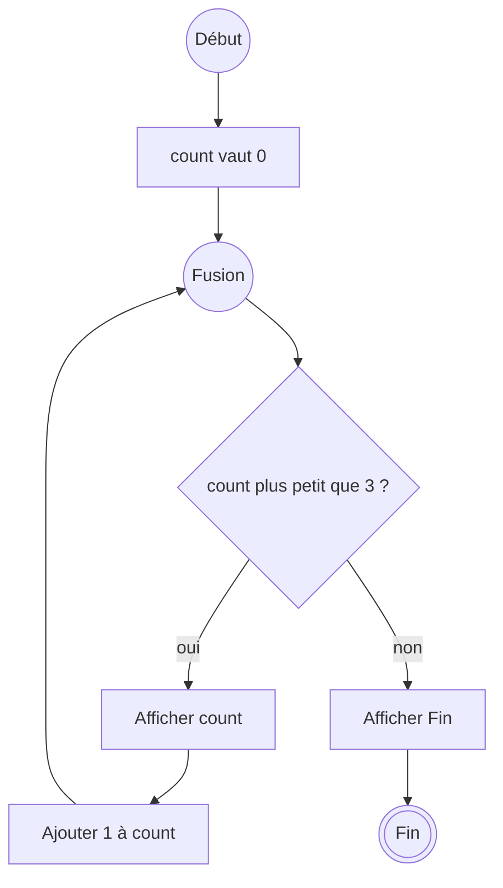

# Répéter avec `while`

V. Guidoux, avec l'aide de Claude.

Ce travail est sous licence [CC BY-SA 4.0][licence].

## Objectif

Traduire en Java la flèche qui remonte des diagrammes d'activité : répéter un
bloc tant qu'une condition est vraie. À la fin de cette page, vous saurez
écrire une boucle `while`, la dérouler à la main, et reconnaître celle qui ne
s'arrête jamais.

!!! note "Comment lire les exemples de cette page"

    Comme depuis la séance 05, chaque exemple montre le fichier `Main.java`
    **en entier**, avec ses numéros de ligne. Les lignes **surlignées** sont
    celles qui comptent dans l'exemple, ou celle que désigne le message
    d'erreur.

    Les blocs **Quiz** sont des questions à choix multiple : cliquez sur une
    réponse. Répondez avant de lire la suite, c'est là qu'ils servent.

## Rappel : un `if` ne se répète pas

```java title="Main.java" linenums="1" hl_lines="5-8"
public class Main {
    public static void main(String[] args) {
        int count = 0;

        if (count < 3) {
            System.out.println(count);
            count++;
        }
        System.out.println("Fin");
    }
}
```

<div class="quiz" markdown>

Qu'affiche ce programme ?

- [ ] `0 1 2 Fin`
- [x] `0 Fin`
- [ ] `0 1 2 3 Fin`
- [ ] `Fin`

<div class="quiz-explanation" markdown>

Ligne 5, `count` vaut 0 et `0 < 3` est vrai : le bloc s'exécute **une fois**.
Il affiche `0`, puis `count` passe à 1. Ensuite, Java continue à la ligne 9.
Il ne revient pas à la ligne 5 : un `if` décide une fois, il ne répète pas.

Si vous avez répondu `0 1 2 Fin`, vous avez lu ce programme comme une boucle.
C'est exactement ce que fait le mot de cette page.

</div>

</div>

## Remplacer `if` par `while`

Changeons un seul mot, ligne 5 :

```java title="Main.java" linenums="1" hl_lines="5"
public class Main {
    public static void main(String[] args) {
        int count = 0;

        while (count < 3) {
            System.out.println(count);
            count++;
        }
        System.out.println("Fin");
    }
}
```

```text
0
1
2
Fin
```

`while` se lit _"tant que"_. Tant que `count < 3` est vrai, Java exécute le
bloc. Arrivé à l'accolade fermante, ligne 8, il **remonte** à la ligne 5 et
pose à nouveau la question. Quand la réponse est `false`, il saute le bloc et
continue à la ligne 9.

C'est la flèche qui remonte de vos diagrammes de la séance 01 :



| Dans le diagramme       | En Java                                     |
| :---------------------- | :------------------------------------------ |
| Le losange              | `while`                                     |
| La question             | La **condition**, entre parenthèses         |
| Le chemin `[oui]`       | Le **corps** de la boucle, entre accolades  |
| La flèche qui remonte   | L'accolade fermante : retour à la condition |
| Le chemin `[non]`       | La ligne qui suit l'accolade fermante       |

On appelle **tour** (ou itération) une exécution du corps de la boucle. Ici, il
y a trois tours.

## Les trois ingrédients d'une boucle

En séance 01, deux règles accompagnaient la flèche qui remonte : la condition
de sortie existe, et quelque chose change à chaque tour. En Java, cela donne
trois ingrédients, que l'on retrouve dans toutes les boucles de ce cours.

```java title="Main.java" linenums="1" hl_lines="3 5 7"
public class Main {
    public static void main(String[] args) {
        int i = 0;

        while (i <= 5) {
            System.out.println(i);
            i++;
        }
        System.out.println("Fin");
    }
}
```

```text
0
1
2
3
4
5
Fin
```

| Ingrédient                | Ligne | Rôle                                               |
| :------------------------ | :---: | :------------------------------------------------- |
| La **situation initiale** |   3   | `int i = 0;` : d'où l'on part, **avant** la boucle |
| La **condition**          |   5   | `i <= 5` : tant qu'elle est vraie, on continue     |
| La **mise à jour**        |   7   | `i++;` : ce qui change à chaque tour               |

`i++` ajoute 1 à `i`, comme en séance 04. Son symétrique, `i--`, retire 1. Une
variable qui compte les tours s'appelle souvent `i`, par convention : c'est
l'une des rares exceptions à la règle des noms parlants.

S'il manque un ingrédient, la boucle est fausse :

- sans situation initiale, `i` n'existe pas et le programme ne compile pas ;
- avec une mauvaise condition, la boucle fait un tour de trop ou de moins ;
- sans mise à jour, la condition ne change jamais et la boucle ne s'arrête
  plus.

## Dérouler une boucle à la main

Pour comprendre ce que fait une boucle, on la **déroule** : on note, tour après
tour, la valeur de chaque variable au moment où la condition est posée. C'est
un **tableau de trace**. Voici celui du programme précédent :

| Condition posée | `i` | `i <= 5` | Ce qui s'affiche | `i` en fin de tour |
| :-------------- | --: | :------: | :--------------- | -----------------: |
| 1^re^ fois      |   0 |  `true`  | `0`              |                  1 |
| 2^e^ fois       |   1 |  `true`  | `1`              |                  2 |
| 3^e^ fois       |   2 |  `true`  | `2`              |                  3 |
| 4^e^ fois       |   3 |  `true`  | `3`              |                  4 |
| 5^e^ fois       |   4 |  `true`  | `4`              |                  5 |
| 6^e^ fois       |   5 |  `true`  | `5`              |                  6 |
| 7^e^ fois       |   6 | `false`  | on sort          |                    |

La condition est posée **sept fois** pour **six tours** : la dernière fois,
c'est elle qui fait sortir. Et _"compter de 0 à 5"_ affiche six nombres, pas
cinq.

C'est long et un peu pénible. C'est aussi la seule méthode qui marche quand une
boucle ne fait pas ce que vous attendez. Vous en ferez dans l'atelier.

<div class="quiz" markdown>

Combien de fois ce programme affiche-t-il `Bonjour` ?

```java title="Main.java" linenums="1" hl_lines="5"
public class Main {
    public static void main(String[] args) {
        int i = 0;

        while (i < 5) {
            System.out.println("Bonjour");
            i++;
        }
    }
}
```

- [ ] 4 fois
- [x] 5 fois
- [ ] 6 fois
- [ ] Sans fin

<div class="quiz-explanation" markdown>

`i` prend les valeurs 0, 1, 2, 3 et 4 dans le corps : cinq tours. Quand `i`
vaut 5, `5 < 5` est faux et la boucle s'arrête. Avec `i <= 5`, il y aurait eu
six tours.

`<` ou `<=` : un caractère, un tour de différence. C'est l'erreur la plus
fréquente avec les boucles. Elle a même un nom en anglais : _off-by-one_.

</div>

</div>

## La condition n'est posée qu'au début du tour

Dans ce programme, la mise à jour vient **avant** l'affichage :

```java title="Main.java" linenums="1" hl_lines="6-7"
public class Main {
    public static void main(String[] args) {
        int i = 0;

        while (i < 3) {
            i++;
            System.out.println(i);
        }
        System.out.println("Fin");
    }
}
```

<div class="quiz" markdown>

Qu'affiche ce programme ?

- [ ] `0 1 2 Fin`
- [ ] `1 2 Fin`
- [x] `1 2 3 Fin`
- [ ] `0 1 2 3 Fin`

<div class="quiz-explanation" markdown>

Au troisième tour, `i` vaut 2 : `2 < 3` est vrai, on entre dans le corps.
Ligne 6, `i` passe à 3. La condition `i < 3` est maintenant fausse, mais Java
ne la regarde pas : il termine le tour et affiche `3`. Il ne la reposera qu'en
remontant à la ligne 5.

</div>

</div>

```text
1
2
3
Fin
```

C'est l'idée fausse la plus répandue sur les boucles : croire que Java surveille
la condition en permanence, et sort de la boucle dès qu'elle devient fausse.
Non. La condition est une **porte** à l'entrée de chaque tour. Une fois passée,
le tour va jusqu'au bout.

## Une boucle qui ne tourne pas du tout

Si la condition est fausse dès la première fois, le corps n'est jamais
exécuté :

```java title="Main.java" linenums="1" hl_lines="3 5"
public class Main {
    public static void main(String[] args) {
        int i = 10;

        while (i <= 5) {
            System.out.println(i);
            i++;
        }
        System.out.println("Fin");
    }
}
```

```text
Fin
```

Zéro tour, c'est permis. Ce n'est pas une erreur, et le compilateur ne dit
rien.

## Une boucle qui ne s'arrête jamais

### La mise à jour oubliée

```java title="Main.java" linenums="1" hl_lines="5-7"
public class Main {
    public static void main(String[] args) {
        int i = 0;

        while (i <= 5) {
            System.out.println(i);
        }
        System.out.println("Fin");
    }
}
```

```text
0
0
0
0
...
```

`i` vaut 0 et ne change jamais : `0 <= 5` reste vrai pour toujours. Le
programme affiche `0` jusqu'à ce que vous l'arrêtiez. C'est une **boucle
infinie**.

Pour l'arrêter dans IntelliJ : le **carré rouge** de la fenêtre d'exécution, ou
++ctrl+f2++ (++cmd+f2++ sur macOS). Tout le monde écrit des boucles infinies.
L'important est de savoir les arrêter, puis de chercher l'ingrédient qui manque.

### Le point-virgule après la condition

```java title="Main.java" linenums="1" hl_lines="5"
public class Main {
    public static void main(String[] args) {
        int i = 0;

        while (i <= 5); {
            System.out.println(i);
            i++;
        }
        System.out.println("Fin");
    }
}
```

Ce programme compile, et n'affiche **rien**. Il ne s'arrête pas non plus.

Comme pour le `if` de la séance 06, le `;` termine le `while`. La boucle a un
corps vide, qui ne change pas `i`, et elle tourne sans fin sur la ligne 5. Le
bloc entre accolades qui suit n'en fait plus partie, et n'est jamais atteint.

## Accumuler au fil des tours

Une boucle sert rarement à afficher des nombres. Elle sert surtout à
**construire un résultat** petit à petit. Pour additionner 1, 2, 3 et 4 :

```java title="Main.java" linenums="1" hl_lines="3 7"
public class Main {
    public static void main(String[] args) {
        int sum = 0;
        int i = 1;

        while (i <= 4) {
            sum = sum + i;
            i++;
        }
        System.out.println("Somme : " + sum);
    }
}
```

```text
Somme : 10
```

`sum` est un **accumulateur** : une variable déclarée avant la boucle, qui part
de 0 et à laquelle chaque tour ajoute quelque chose.

| Condition posée | `i` | `i <= 4` | `sum` en fin de tour |
| :-------------- | --: | :------: | -------------------: |
| 1^re^ fois      |   1 |  `true`  |                    1 |
| 2^e^ fois       |   2 |  `true`  |                    3 |
| 3^e^ fois       |   3 |  `true`  |                    6 |
| 4^e^ fois       |   4 |  `true`  |                   10 |
| 5^e^ fois       |   5 | `false`  |            on sort   |

Un **compteur** est un accumulateur qui ajoute 1 au lieu d'une valeur :
`count++`, souvent dans un `if`, pour compter les tours où quelque chose est
vrai.

### L'accumulateur déclaré dans la boucle

```java title="Main.java" linenums="1" hl_lines="6 10"
public class Main {
    public static void main(String[] args) {
        int i = 1;

        while (i <= 4) {
            int sum = 0;
            sum = sum + i;
            i++;
        }
        System.out.println("Somme : " + sum);
    }
}
```

```text
Main.java:10: error: cannot find symbol
        System.out.println("Somme : " + sum);
                                        ^
  symbol:   variable sum
  location: class Main
1 error
```

C'est la règle de portée des séances 05 et 06 : `sum` est déclarée dans le
corps de la boucle, et disparaît à son accolade fermante, ligne 9. Pire : elle
est **recréée à 0 à chaque tour**. Même si on pouvait l'afficher, elle ne
contiendrait que le dernier `i`.

Un accumulateur se déclare **avant** la boucle. Toujours.

## Redemander tant que la réponse est fausse

En séance 06, le programme refusait une note de 7, mais ne savait pas la
redemander. Il fallait **répéter** la question, autant de fois que nécessaire.

```java title="Main.java" linenums="1" hl_lines="7 9-12"
public class Main {
    public static boolean isValidGrade(double grade) {
        return (grade >= 1) && (grade <= 6);
    }

    public static void main(String[] args) {
        double grade = Double.parseDouble(IO.readln("Note : "));

        while (!isValidGrade(grade)) {
            System.out.println("Note invalide, entre 1 et 6");
            grade = Double.parseDouble(IO.readln("Note : "));
        }
        System.out.println("Note acceptée : " + grade);
    }
}
```

```text
Note : 7
Note invalide, entre 1 et 6
Note : 0
Note invalide, entre 1 et 6
Note : 4.5
Note acceptée : 4.5
```

Les trois ingrédients sont là, mais ils ne ressemblent plus à un compteur :

| Ingrédient            | Ligne | Ici                                           |
| :-------------------- | :---: | :-------------------------------------------- |
| La situation initiale |   7   | La première saisie                            |
| La condition          |   9   | `!isValidGrade(grade)` : la note est mauvaise |
| La mise à jour        |  11   | Une nouvelle saisie                           |

Cette boucle-ci ne sait pas combien de tours elle fera : zéro si la première
note est bonne, dix si la personne s'obstine. C'est le cas typique du `while`.

!!! warning "La ligne 7 et la ligne 11 se ressemblent"

    Si vous oubliez la ligne 11, la note n'est jamais redemandée et le message
    s'affiche sans fin. Si vous oubliez la ligne 7, `grade` n'a pas de valeur
    à la ligne 9 et le programme ne compile pas. Cette répétition est un peu
    gênante. La boucle `do-while`, en fin de séance, la fait disparaître.

## Résumé

| Diagramme d'activité  | Java                                          |
| :-------------------- | :-------------------------------------------- |
| Losange               | `while (condition) { ... }`                   |
| Chemin `[oui]`        | Le corps de la boucle                         |
| Flèche qui remonte    | L'accolade fermante : retour à la condition   |
| Chemin `[non]`        | La ligne qui suit l'accolade fermante         |

- Une boucle a trois ingrédients : la **situation initiale**, avant la boucle,
  la **condition**, et la **mise à jour**, dans le corps.
- La condition est posée au **début** de chaque tour, jamais au milieu.
- Une boucle peut faire zéro tour.
- Sans mise à jour, ou avec un `;` après la condition, la boucle ne s'arrête
  jamais.
- `<` ou `<=` : un tour de différence. Déroulez la boucle pour savoir.
- Un accumulateur se déclare avant la boucle et part de 0.

## Pour aller plus loin

- [Manipulez vos données](https://openclassrooms.com/fr/courses/8383791-apprenez-a-programmer-en-java/8439941-manipulez-vos-donnees) -
  le chapitre correspondant d'OpenClassrooms, en français, section sur les
  boucles. Sa boucle `for each` porte sur des listes, qui ne sont pas au
  programme de ce cours.
- [The while and do-while Statements](https://docs.oracle.com/javase/tutorial/java/nutsandbolts/while.html) -
  tutoriel officiel de Java, en anglais.
- [Java Visualizer de Python Tutor](https://pythontutor.com/java.html) - collez
  un des programmes de cette page, avancez pas à pas, et comparez avec votre
  tableau de trace.

<!-- URLs -->

[licence]:
	https://github.com/heig-vd-progim-course/heig-vd-progim1-course/blob/main/LICENSE.md
