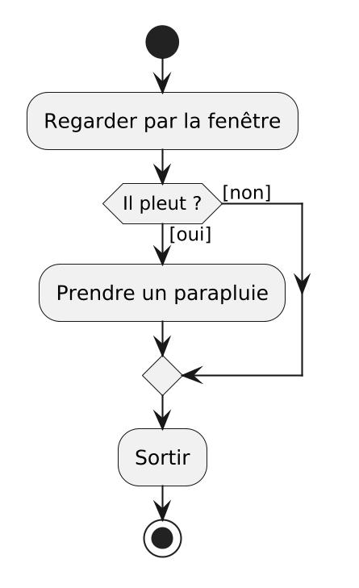

<!--
Générer le PDF depuis la racine du dépôt :

```sh
./generate-evaluations.sh
```
-->

```{=latex}
\nametable

\vspace{1cm}

\noticebox{Corrigé de l'examen blanc.}

\vspace{1cm}
```

Les bonnes réponses sont cochées. Chaque explication renvoie à la séance et à la
page du support de cours où la situation a été rencontrée : c'est là qu'il faut
retourner en cas d'erreur.

```{=latex}
\newpage
```

## Partie A : Vrai ou faux

_**Note** : chaque question de cette partie vaut 1 point._

### Question 1 (1 point)

Dans un diagramme d'activité, une flèche qui part d'une décision porte une
condition écrite entre crochets, par exemple `[il pleut]`.

- [x] Vrai
- [ ] Faux

> **Corrigé** : c'est la première des deux règles de lecture. _Séance 01, Les
> diagrammes d'activité._

### Question 2 (1 point)

Dans un diagramme d'activité, une **fusion** est un losange qui pose une
question, avec une condition entre crochets sur chaque flèche qui en part.

- [ ] Vrai
- [x] Faux

> **Corrigé** : c'est la définition d'une **décision**. Une fusion est un
> losange où plusieurs chemins se rejoignent, et d'où l'on repart sur un seul
> chemin. _Séance 01, Les diagrammes d'activité._

### Question 3 (1 point)

Dans MakeCode Arcade, le bloc `quand le bouton A est pressé` s'exécute lorsque
le programme arrive à lui, en lisant les blocs de haut en bas.

- [ ] Vrai
- [x] Faux

> **Corrigé** : c'est un **événement**. Le bloc attend, et il s'exécute quand
> quelque chose arrive de l'extérieur du programme, sans qu'aucune ligne ne
> l'ait appelé. _Séance 02, Observer._

### Question 4 (1 point)

Le ramasse-miettes, ou _garbage collector_, est un service de la machine
virtuelle Java qui libère la mémoire occupée par ce qui n'est plus utilisé.

- [x] Vrai
- [ ] Faux

> **Corrigé** : _Séance 03, Machine virtuelle et compilation._

### Question 5 (1 point)

Le JDK contient le JRE, qui contient la JVM.

- [x] Vrai
- [ ] Faux

> **Corrigé** : la JVM exécute le bytecode, le JRE y ajoute les bibliothèques de
> base, le JDK y ajoute le compilateur `javac`. _Séance 03, Machine virtuelle et
> compilation._

### Question 6 (1 point)

Un `String` peut s'écrire entre apostrophes simples, comme `'Bonjour'`.

- [ ] Vrai
- [x] Faux

> **Corrigé** : les apostrophes simples sont réservées au type `char`, qui ne
> contient qu'un seul caractère. `String salutation = 'Bonjour';` provoque
> l'erreur de compilation `unclosed character literal`. _Séance 03, Types et
> variables._

### Question 7 (1 point)

Dans `age = age + 1;`, le signe `=` affirme que `age` est égal à `age + 1`,
comme en mathématiques.

- [ ] Vrai
- [x] Faux

> **Corrigé** : c'est une **affectation**, pas une équation. Java calcule
> `age + 1`, puis range le résultat dans `age`. _Séance 03, Types et variables._

### Question 8 (1 point)

Le programme suivant compile sans erreur.

```{.java .numberLines}
public class Main {
    public static void main(String[] args) {
        int total = 15;
        int nombre = 0;
        System.out.println(total / nombre);
    }
}
```

- [x] Vrai
- [ ] Faux

> **Corrigé** : diviser un entier par un autre est une opération légale, le
> compilateur n'a rien à redire. C'est la valeur `0` qui pose problème, et elle
> n'est rencontrée qu'à l'exécution :
> `java.lang.ArithmeticException: / by zero`, à la ligne 5. C'est une **erreur à
> l'exécution**. _Séance 03, Machine virtuelle et compilation._

### Question 9 (1 point)

`(int) 3.99` vaut `3`.

- [x] Vrai
- [ ] Faux

> **Corrigé** : un **transtypage** vers `int` tronque, il n'arrondit pas. Pour
> arrondir, il y a `Math.round`. _Séance 03, Types et variables._

### Question 10 (1 point)

`IO.readln("Votre note : ")` rend un `String`, même quand la personne tape un
nombre.

- [x] Vrai
- [ ] Faux

> **Corrigé** : il faut ensuite le convertir avec `Double.parseDouble` ou
> `Integer.parseInt`. _Séance 04, Lire au clavier._

### Question 11 (1 point)

Dans `System.out.printf("Moyenne : %.1f%n", average);`, le `%.1f` arrondit au
dixième la valeur rangée dans `average`.

- [ ] Vrai
- [x] Faux

> **Corrigé** : `%.1f` arrondit ce qui est **affiché**, pas la valeur. La
> variable `average` n'a pas changé. C'est pourquoi les notes 3.3 et 4.6 donnent
> `3.9` à l'affichage, et non `4.0`. _Séance 04, Afficher un résultat._

### Question 12 (1 point)

Dans l'appel `walkingMinutes(10, 5)`, `10` et `5` sont des arguments.

- [x] Vrai
- [ ] Faux

> **Corrigé** : un **argument** est la valeur donnée au moment de l'appel. Elle
> est copiée dans le **paramètre** correspondant, ici `distanceKm` et
> `speedKmh`. _Séance 05, Fonctions et portée._

### Question 13 (1 point)

En Java, toute fonction est écrite dans une classe, et s'appelle donc
officiellement une méthode.

- [x] Vrai
- [ ] Faux

> **Corrigé** : _Séance 05, Fonctions et portée, section "Fonction ou méthode"._

### Question 14 (1 point)

Une variable déclarée dans `computeAverage` peut être utilisée dans `main`, une
fois que `main` a appelé `computeAverage`.

- [ ] Vrai
- [x] Faux

> **Corrigé** : une variable n'existe qu'entre sa déclaration et l'accolade
> fermante du bloc où elle est déclarée : c'est sa **portée**. Une variable
> **locale** à `computeAverage` disparaît quand la fonction se termine. Pour
> faire sortir une valeur, il n'y a qu'un chemin : `return`. _Séance 05,
> Fonctions et portée._

### Question 15 (1 point)

Une constante déclarée avec `final double PASSING_GRADE = 4.0;` peut recevoir
une nouvelle valeur plus loin dans `main`, avec `PASSING_GRADE = 3.5;`.

- [ ] Vrai
- [x] Faux

> **Corrigé** : `final` déclare une **constante**, qu'on ne peut plus modifier
> après sa création. Le compilateur refuse :
> `cannot assign a value to final variable PASSING_GRADE`. _Séance 03, Types et
> variables._

## Partie B : Choix multiple

_**Note** : chaque question de cette partie vaut 2 points. Il est possible qu'il
y ait zéro, une, plusieurs ou toutes les réponses qui soient correctes. Tout
doit être correct pour obtenir les points._

### Question 16 (2 points)

En séance 01, nous avons vu que tout programme se construit avec trois
structures, et rien d'autre. Lesquelles ?

- [x] La séquence
- [x] La sélection
- [x] L'itération
- [ ] L'événement

> **Corrigé** : c'est le théorème de Böhm-Jacopini. L'événement, vu en séance
> 02, ne fait pas partie de ces trois structures. _Séance 01, Les diagrammes
> d'activité._

### Question 17 (2 points)

Voici le diagramme d'activité _"Sortir de chez soi"_ de la séance 01.

{width=35%}

Que contient ce diagramme ?

- [x] Une décision
- [x] Une fusion
- [ ] Une itération
- [x] Un nœud final

> **Corrigé** : le losange _"Il pleut ?"_ est une décision, le losange du bas
> est une fusion où les deux chemins se rejoignent. Aucune flèche ne remonte :
> il n'y a pas d'itération. Le disque cerclé du bas est le nœud final. _Séance
> 01, Les diagrammes d'activité._

### Question 18 (2 points)

En séance 03, vous avez compilé et exécuté `Bonjour.java` dans un terminal.
Quelles affirmations sont correctes ?

- [x] `javac Bonjour.java` produit un fichier `Bonjour.class`, qui contient du
      bytecode
- [x] `java Bonjour` demande à la machine virtuelle Java d'exécuter la classe
      `Bonjour`
- [x] Le même `Bonjour.class` s'exécute sous Windows, macOS et Linux sans être
      recompilé
- [ ] `javac` lit le code ligne par ligne et exécute chaque instruction au fur
      et à mesure, comme un interpréteur

> **Corrigé** : `javac` est un **compilateur** : il traduit tout le code source
> en bytecode, avant l'exécution. C'est la JVM qui exécute ce bytecode, ce qui
> rend le programme portable. _Séance 03, Machine virtuelle et compilation._

**Les questions 19 à 21 portent sur le programme suivant.**

```{.java .numberLines}
public class Main {
    public static void main(String[] args) {
        final int BONUS = 5;
        int score = 10;
        System.out.println("Score de départ : " + score);
        score = score + BONUS;
        System.out.println("Après bonus : " + score);
    }
}
```

### Question 19 (2 points)

Quelles lignes contiennent une **déclaration** de variable ?

- [x] La ligne 3
- [x] La ligne 4
- [ ] La ligne 5
- [ ] La ligne 6

> **Corrigé** : une déclaration commence par un type. La ligne 3 déclare une
> constante, la ligne 4 une variable. La ligne 6 n'a pas de type : elle utilise
> une variable qui existe déjà. _Séance 03, Types et variables._

### Question 20 (2 points)

Dans la ligne 4, `int score = 10;`, quelles affirmations sont correctes ?

- [x] `int` est le type de la variable
- [x] `score` est le nom de la variable
- [x] `10` est la valeur initiale de la variable
- [ ] `=` compare `score` et `10`

> **Corrigé** : type, nom, valeur initiale, dans cet ordre. Le `=` range la
> valeur dans la variable, il ne compare rien. _Séance 03, Types et variables._

### Question 21 (2 points)

Dans la ligne 6, `score = score + BONUS;`, quelles affirmations sont correctes ?

- [x] C'est une affectation
- [ ] C'est une déclaration
- [x] Avant d'exécuter la ligne, Java remplace le `score` de droite par `10`
- [ ] Après la ligne 6, `BONUS` vaut `15`

> **Corrigé** : seul le `score` de droite est remplacé par sa valeur. Celui de
> gauche désigne l'endroit où ranger le résultat, `15`. `BONUS` est une
> constante, elle vaut toujours `5`. _Séance 03, Types et variables._

### Question 22 (2 points)

Parmi les situations suivantes, lesquelles provoquent une **erreur à
l'exécution** ?

- [x] Taper `quatre` quand le programme exécute
      `Double.parseDouble(IO.readln("Votre note : "))`
- [ ] Écrire `int age = "vingt";`
- [x] Exécuter `System.out.printf("Moyenne : %d%n", average);` avec
      `double average = 4.75;`
- [ ] Oublier le `;` à la fin de `System.out.println("Bonjour")`

> **Corrigé** : `quatre` provoque une `NumberFormatException`, et `%d` pour un
> `double` une `IllegalFormatConversionException`. Dans les deux cas, le
> programme compilait et s'arrête pendant qu'il tourne. `int age = "vingt";`
> (`incompatible types`) et le `;` oublié (`';' expected`) sont des **erreurs de
> compilation** : le programme ne démarre pas. _Séances 03 et 04._

### Question 23 (2 points)

Parmi les situations suivantes, lesquelles produisent un **résultat faux sans
aucun message d'erreur** ?

- [x] Afficher `somme / 3` pour la moyenne des notes 5, 4 et 5, rangée dans
      `int somme`
- [x] Appeler `computeFinalGrade(project, exam)`, dont les paramètres sont, dans
      l'ordre, `exam` puis `project`
- [x] Afficher `Integer.MAX_VALUE + 1`
- [ ] Afficher `5 / 0`

> **Corrigé** : `somme / 3` est une division entière et affiche `4` au lieu de
> `4.666...`. Les arguments inversés donnent `4.3` au lieu de `3.7` : Java ne
> regarde que la position. `Integer.MAX_VALUE + 1` donne `-2147483648`, un
> dépassement de capacité. `5 / 0`, lui, arrête le programme avec une
> `ArithmeticException` : il y a bien un message. _Séances 03, 04 et 05._

### Question 24 (2 points)

En séance 05, les trois colonnes de la séance 04 (entrées, traitement, sortie)
ont été reliées aux parties d'une fonction. Quelles correspondances sont
correctes ?

- [x] Les entrées correspondent aux paramètres
- [x] Le traitement correspond au corps de la fonction
- [x] La sortie correspond à la valeur de retour
- [ ] La sortie correspond aux arguments

> **Corrigé** : une fonction reçoit ses paramètres, les traite dans son corps et
> rend sa valeur de retour avec `return`. Les arguments sont les valeurs données
> à l'appel : ce sont des entrées. _Séance 05, Fonctions et portée._

```{=latex}
\newpage
```

**Les questions 25 à 28 portent sur le programme suivant.**

```{.java .numberLines}
public class Main {
    public static double roundToTenth(double value) {
        double rounded = Math.round(value * 10) / 10.0;
        return rounded;
    }

    public static void main(String[] args) {
        double averageCamille = (3.3 + 4.6) / 2;
        double averageNoah = (5.5 + 4.0) / 2;
        double averageLou = (4.5 + 5.0) / 2;

        System.out.println("Camille : " + roundToTenth(averageCamille));
        System.out.println("Noah : " + roundToTenth(averageNoah));
        System.out.println("Lou : " + roundToTenth(averageLou));
    }
}
```

### Question 25 (2 points)

Quelles affirmations sur les lignes 2 à 5 sont correctes ?

- [x] Le `double` de la ligne 2 est le type de retour de la fonction
- [ ] `value` est un argument
- [x] La ligne 2, jusqu'à l'accolade, est l'en-tête de la fonction
- [x] Les lignes 3 et 4 forment le corps de la fonction

> **Corrigé** : `value` est un **paramètre** : la variable déclarée dans
> l'en-tête. _Séance 05, Fonctions et portée, section "Le vocabulaire"._

### Question 26 (2 points)

Quelles affirmations sur la ligne 12 sont correctes ?

- [x] `roundToTenth(averageCamille)` est un appel de fonction
- [x] `averageCamille` est un argument
- [x] La valeur de `averageCamille` est copiée dans `value`
- [x] Une fois la fonction terminée, `roundToTenth(averageCamille)` est remplacé
      par la valeur rendue par `return`

> **Corrigé** : les quatre sont correctes. Un appel est remplacé par ce qu'il
> rend, comme une variable est remplacée par sa valeur. _Séance 05, Fonctions et
> portée._

### Question 27 (2 points)

Quelle est la **signature** de la fonction, au sens de ce cours ?

- [ ] `public static double roundToTenth(double value)`
- [x] `roundToTenth(double)`
- [ ] `double roundToTenth(double value)`
- [ ] `roundToTenth(averageCamille)`

> **Corrigé** : la signature est le nom et la liste des types des paramètres. Le
> type de retour, les modificateurs et les noms des paramètres n'en font pas
> partie. C'est la définition de la documentation officielle de Java. _Séance
> 05, Fonctions et portée, section "La signature"._

### Question 28 (2 points)

Quelles variables sont des **variables locales de `main`** ?

- [x] `averageCamille`
- [x] `averageLou`
- [ ] `rounded`
- [ ] `value`

> **Corrigé** : `rounded` et `value` sont déclarées dans `roundToTenth`, aux
> lignes 3 et 2 : elles n'existent que dans cette fonction. _Séance 05,
> Fonctions et portée, section "La portée des variables"._

### Question 29 (2 points)

Quelles affirmations sur une fonction dont le type de retour est `void` sont
correctes ?

- [x] Elle ne rend aucune valeur
- [x] `main` en est une
- [ ] Son appel peut être rangé dans une variable, par exemple
      `double result = printAverage("Noah", 4.8);`
- [ ] Son corps doit se terminer par `return` suivi d'une valeur

> **Corrigé** : l'appel d'une fonction `void` ne vaut rien. Le ranger dans une
> variable provoque l'erreur de compilation
> `incompatible types: void cannot be converted to double`. _Séance 05,
> Fonctions et portée._

```{=latex}
\newpage
```

## Partie C : Lecture de code

_**Note** : chaque question de cette partie vaut 2 points. Une seule réponse est
correcte._

### Question 30 (2 points)

Qu'affiche ce programme ?

```{.java .numberLines}
public class Main {
    public static void main(String[] args) {
        double a = 4.0;
        double b = a;
        a = 6.0;
        System.out.println(a);
        System.out.println(b);
    }
}
```

- [ ] `6.0`, puis `6.0`
- [x] `6.0`, puis `4.0`
- [ ] `4.0`, puis `4.0`
- [ ] Une erreur de compilation

> **Corrigé** : à la ligne 4, `a` est remplacée par sa valeur : `b` reçoit une
> **copie** de `4.0`, pas un lien vers `a`. _Séance 03, Types et variables._

### Question 31 (2 points)

Qu'affiche ce programme ?

```{.java .numberLines}
public class Main {
    public static void main(String[] args) {
        System.out.println("1" + 2 + 3);
        System.out.println(1 + 2 + "3");
    }
}
```

- [ ] `6`, puis `6`
- [ ] `123`, puis `123`
- [x] `123`, puis `33`
- [ ] `15`, puis `33`

> **Corrigé** : Java lit de gauche à droite. Ligne 3, il rencontre d'abord du
> texte et colle tout. Ligne 4, il additionne `1 + 2`, puis colle `"3"`. _Séance
> 03, Types et variables, section "La concaténation"._

### Question 32 (2 points)

Qu'affiche ce programme ?

```{.java .numberLines}
public class Main {
    public static void main(String[] args) {
        double grade1 = 4.0;
        double grade2 = 5.0;
        System.out.println(grade1 + grade2 / 2);
    }
}
```

- [ ] `4.5`
- [x] `6.5`
- [ ] `4.0`
- [ ] `9.0`

> **Corrigé** : `/` passe avant `+`. Java calcule `4.0 + 2.5`. Pour la moyenne,
> il faut des parenthèses : `(grade1 + grade2) / 2`. _Séance 04, Opérations
> arithmétiques._

### Question 33 (2 points)

Noah et Lou ont la même moyenne exacte, 4.75. Que vaut la **dernière** ligne
affichée par ce programme ?

```{.java .numberLines}
public class Main {
    public static void main(String[] args) {
        double averageCamille = (3.3 + 4.6) / 2;
        double roundedCamille = Math.round(averageCamille * 10) / 10.0;

        double averageNoah = (5.5 + 4.0) / 2;
        double roundedNoah = Math.round(averageNoah * 10) / 10.0;

        double averageLou = (4.5 + 5.0) / 2;
        double roundedLou = Math.round(averageLou * 10) / 10;

        System.out.println("Camille : " + roundedCamille);
        System.out.println("Noah : " + roundedNoah);
        System.out.println("Lou : " + roundedLou);
    }
}
```

- [ ] `Lou : 4.8`
- [x] `Lou : 4.0`
- [ ] `Lou : 4.75`
- [ ] `Lou : 4`

> **Corrigé** : à la ligne 10, `/ 10` au lieu de `/ 10.0`. `Math.round` rend
> l'entier `48`, divisé par l'entier `10` : division entière, `4`. Rangé dans un
> `double`, il devient `4.0`. C'est pour éviter ce genre de copie qu'on écrit
> une fonction. _Séance 05, Fonctions et portée, section "Pourquoi écrire ses
> propres fonctions"._

### Question 34 (2 points)

Qu'affiche ce programme ?

```{.java .numberLines}
public class Main {
    public static int addTen(int x) {
        x = x + 10;
        return x;
    }

    public static void main(String[] args) {
        int x = 5;
        addTen(x);
        System.out.println(x);
        x = addTen(x);
        System.out.println(x);
    }
}
```

- [ ] `15`, puis `15`
- [x] `5`, puis `15`
- [ ] `5`, puis `5`
- [ ] Une erreur de compilation, parce que deux variables s'appellent `x`

> **Corrigé** : ligne 9, la valeur rendue est perdue : personne ne la récupère.
> Ligne 11, elle est rangée dans le `x` de `main`. Les deux `x` sont des
> variables différentes, déclarées dans deux fonctions différentes : c'est
> permis. _Séance 05, Atelier, programme C._

### Question 35 (2 points)

Qu'affiche ce programme ?

```{.java .numberLines}
public class Main {
    public static double half(double value) {
        System.out.println("half reçoit " + value);
        return value / 2;
    }

    public static void main(String[] args) {
        System.out.println("Début");
        double result = half(10) + half(4);
        System.out.println("Résultat : " + result);
    }
}
```

- [ ] `Début`, `Résultat : 7.0`, `half reçoit 10.0`, `half reçoit 4.0`
- [x] `Début`, `half reçoit 10.0`, `half reçoit 4.0`, `Résultat : 7.0`
- [ ] `Début`, `half reçoit 10`, `half reçoit 4`, `Résultat : 7.0`
- [ ] `half reçoit 10.0`, `half reçoit 4.0`, `Début`, `Résultat : 7.0`

> **Corrigé** : le programme commence par `main` et suit les appels. Les deux
> appels de la ligne 9 sont exécutés avant l'addition, de gauche à droite. Les
> arguments `10` et `4` sont des `int`, copiés dans un paramètre `double` : ils
> deviennent `10.0` et `4.0`. _Séance 05, Atelier, programme B._

### Question 36 (2 points)

Qu'affiche ce programme ?

```{.java .numberLines}
public class Main {
    public static double computeAverage(int grade1, int grade2) {
        return (grade1 + grade2) / 2;
    }

    public static void main(String[] args) {
        System.out.println(computeAverage(4, 5));
    }
}
```

- [ ] `4.5`
- [x] `4.0`
- [ ] `4`
- [ ] Une erreur de compilation

> **Corrigé** : `grade1 + grade2` est un `int`, divisé par l'`int` `2` :
> division entière, `4`. Le type de retour `double` arrive trop tard, il
> transforme seulement `4` en `4.0`. _Séance 05, Atelier, programme D._

### Question 37 (2 points)

Que se passe-t-il quand on compile ce programme ?

```{.java .numberLines}
public class Main {
    public static double toFahrenheit(double celsius) {
        double fahrenheit = ((celsius * 9) / 5) + 32;
        return fahrenheit;
    }

    public static void main(String[] args) {
        double temperature = 20;
        toFahrenheit(temperature);
        System.out.println(temperature + " °C = " + fahrenheit + " °F");
    }
}
```

- [ ] Il compile, et affiche `20.0 °C = 68.0 °F` à l'exécution
- [ ] Il compile, et s'arrête avec une erreur à l'exécution
- [x] Erreur de compilation à la ligne 10 : `cannot find symbol`, la variable
      `fahrenheit` n'existe pas à cet endroit
- [ ] Erreur de compilation à la ligne 3 : `fahrenheit` est déclarée deux fois

> **Corrigé** : `fahrenheit` est déclarée ligne 3, dans `toFahrenheit` : elle
> n'existe que dans cette fonction. Et la valeur rendue ligne 9 est perdue. La
> correction : `double fahrenheit = toFahrenheit(temperature);` à la ligne 9.
> _Séance 05, Atelier, bug 1._

```{=latex}
\vspace*{\fill}
\begin{center}
\textbf{Total : 59 points}
\end{center}
```
