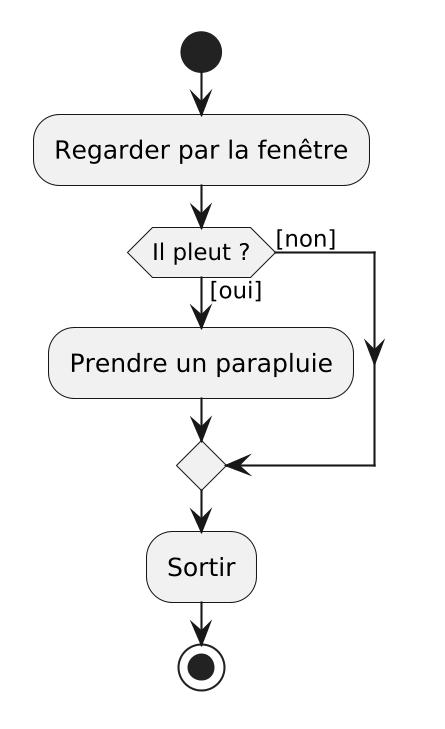

<!--
Générer le PDF depuis la racine du dépôt :

```sh
./generate-evaluations.sh
```
-->

```{=latex}
\nametable

\vspace{0.5cm}

\noticebox{Examen d'entraînement. Il ne compte pas pour la note.}

\vspace{0.3cm}

\begin{center}
\parbox{0.85\textwidth}{\centering\itshape
  Rappelez-vous que cette évaluation ne mesure ni votre intelligence
  émotionnelle et relationnelle, ni votre capacité à rêver, ni votre
  sensibilité artistique. Votre note ne définit pas la richesse de votre
  personnalité.}
\end{center}

\vspace{0.3cm}
```

## Déroulement

Cet examen blanc prépare à l'évaluation écrite du **lundi 9 novembre 2026, de
13h00 à 15h00**. Faites-le dans les mêmes conditions : sur papier, sans
ressource, en temps limité, avant la séance où il est corrigé collectivement.
Ses questions reprennent toutes des situations rencontrées en cours : exemples
des supports, programmes des ateliers, erreurs expliquées.

L'évaluation dure 120 minutes et compte pour 50 % de la note de l'unité
d'enseignement, le mini-projet pour les 50 % restants. Elle porte sur les
**séances 01 à 05**, ateliers compris ; la séance 06 n'est pas évaluée. Elle ne
comporte que des questions **vrai ou faux** et **à choix multiple** : rien à
écrire en code, rien à dessiner. Une bonne partie porte sur le **vocabulaire** :
nommer chaque partie d'un programme, savoir ce qu'est une déclaration, une
affectation, un paramètre ou un argument.

## Ressources autorisées

- Aucune : ni ordinateur, ni téléphone, ni outil d'intelligence artificielle, ni
  notes de cours, ni feuille de résumé.

**Toute tentative de tricherie ou d'utilisation de ressources non autorisées
entraîne la note de 1 pour l'évaluation.**

## Instructions

- Répondre directement sur cette feuille.
- Écrire son nom en haut à droite **sur chaque page**.
- Pour chaque question, cocher la ou les cases correspondantes.

```{=latex}
\newpage
```

## Partie A : Vrai ou faux

_**Note** : chaque question de cette partie vaut 1 point._

### Question 1 (1 point)

Dans un diagramme d'activité, une flèche qui part d'une décision porte une
condition écrite entre crochets, par exemple `[il pleut]`.

- [ ] Vrai
- [ ] Faux

### Question 2 (1 point)

Dans un diagramme d'activité, une **fusion** est un losange qui pose une
question, avec une condition entre crochets sur chaque flèche qui en part.

- [ ] Vrai
- [ ] Faux

### Question 3 (1 point)

Dans MakeCode Arcade, le bloc `quand le bouton A est pressé` s'exécute lorsque
le programme arrive à lui, en lisant les blocs de haut en bas.

- [ ] Vrai
- [ ] Faux

### Question 4 (1 point)

Le ramasse-miettes, ou _garbage collector_, est un service de la machine
virtuelle Java qui libère la mémoire occupée par ce qui n'est plus utilisé.

- [ ] Vrai
- [ ] Faux

### Question 5 (1 point)

Le JDK contient le JRE, qui contient la JVM.

- [ ] Vrai
- [ ] Faux

### Question 6 (1 point)

Un `String` peut s'écrire entre apostrophes simples, comme `'Bonjour'`.

- [ ] Vrai
- [ ] Faux

### Question 7 (1 point)

Dans `age = age + 1;`, le signe `=` affirme que `age` est égal à `age + 1`,
comme en mathématiques.

- [ ] Vrai
- [ ] Faux

### Question 8 (1 point)

Le programme suivant compile sans erreur.

```{.java .numberLines}
public class Main {
    public static void main(String[] args) {
        int total = 15;
        int nombre = 0;
        System.out.println(total / nombre);
    }
}
```

- [ ] Vrai
- [ ] Faux

### Question 9 (1 point)

`(int) 3.99` vaut `3`.

- [ ] Vrai
- [ ] Faux

### Question 10 (1 point)

`IO.readln("Votre note : ")` rend un `String`, même quand la personne tape un
nombre.

- [ ] Vrai
- [ ] Faux

### Question 11 (1 point)

Dans `System.out.printf("Moyenne : %.1f%n", average);`, le `%.1f` arrondit au
dixième la valeur rangée dans `average`.

- [ ] Vrai
- [ ] Faux

### Question 12 (1 point)

Dans l'appel `walkingMinutes(10, 5)`, `10` et `5` sont des arguments.

- [ ] Vrai
- [ ] Faux

### Question 13 (1 point)

En Java, toute fonction est écrite dans une classe, et s'appelle donc
officiellement une méthode.

- [ ] Vrai
- [ ] Faux

### Question 14 (1 point)

Une variable déclarée dans `computeAverage` peut être utilisée dans `main`, une
fois que `main` a appelé `computeAverage`.

- [ ] Vrai
- [ ] Faux

### Question 15 (1 point)

Une constante déclarée avec `final double PASSING_GRADE = 4.0;` peut recevoir
une nouvelle valeur plus loin dans `main`, avec `PASSING_GRADE = 3.5;`.

- [ ] Vrai
- [ ] Faux

## Partie B : Choix multiple

_**Note** : chaque question de cette partie vaut 2 points. Il est possible qu'il
y ait zéro, une, plusieurs ou toutes les réponses qui soient correctes. Tout
doit être correct pour obtenir les points._

### Question 16 (2 points)

En séance 01, nous avons vu que tout programme se construit avec trois
structures, et rien d'autre. Lesquelles ?

- [ ] La séquence
- [ ] La sélection
- [ ] L'itération
- [ ] L'événement

### Question 17 (2 points)

Voici le diagramme d'activité _"Sortir de chez soi"_ de la séance 01.

{width=35%}

Que contient ce diagramme ?

- [ ] Une décision
- [ ] Une fusion
- [ ] Une itération
- [ ] Un nœud final

### Question 18 (2 points)

En séance 03, vous avez compilé et exécuté `Bonjour.java` dans un terminal.
Quelles affirmations sont correctes ?

- [ ] `javac Bonjour.java` produit un fichier `Bonjour.class`, qui contient du
      bytecode
- [ ] `java Bonjour` demande à la machine virtuelle Java d'exécuter la classe
      `Bonjour`
- [ ] Le même `Bonjour.class` s'exécute sous Windows, macOS et Linux sans être
      recompilé
- [ ] `javac` lit le code ligne par ligne et exécute chaque instruction au fur
      et à mesure, comme un interpréteur

**Les questions 19 à 21 portent sur le programme suivant.**

```{.java .numberLines}
public class Main {
    public static void main(String[] args) {
        final int BONUS = 5;
        int score = 10;
        System.out.println("Score de départ : " + score);
        score = score + BONUS;
        System.out.println("Après bonus : " + score);
    }
}
```

### Question 19 (2 points)

Quelles lignes contiennent une **déclaration** de variable ?

- [ ] La ligne 3
- [ ] La ligne 4
- [ ] La ligne 5
- [ ] La ligne 6

### Question 20 (2 points)

Dans la ligne 4, `int score = 10;`, quelles affirmations sont correctes ?

- [ ] `int` est le type de la variable
- [ ] `score` est le nom de la variable
- [ ] `10` est la valeur initiale de la variable
- [ ] `=` compare `score` et `10`

### Question 21 (2 points)

Dans la ligne 6, `score = score + BONUS;`, quelles affirmations sont correctes ?

- [ ] C'est une affectation
- [ ] C'est une déclaration
- [ ] Avant d'exécuter la ligne, Java remplace le `score` de droite par `10`
- [ ] Après la ligne 6, `BONUS` vaut `15`

### Question 22 (2 points)

Parmi les situations suivantes, lesquelles provoquent une **erreur à
l'exécution** ?

- [ ] Taper `quatre` quand le programme exécute
      `Double.parseDouble(IO.readln("Votre note : "))`
- [ ] Écrire `int age = "vingt";`
- [ ] Exécuter `System.out.printf("Moyenne : %d%n", average);` avec
      `double average = 4.75;`
- [ ] Oublier le `;` à la fin de `System.out.println("Bonjour")`

### Question 23 (2 points)

Parmi les situations suivantes, lesquelles produisent un **résultat faux sans
aucun message d'erreur** ?

- [ ] Afficher `somme / 3` pour la moyenne des notes 5, 4 et 5, rangée dans
      `int somme`
- [ ] Appeler `computeFinalGrade(project, exam)`, dont les paramètres sont, dans
      l'ordre, `exam` puis `project`
- [ ] Afficher `Integer.MAX_VALUE + 1`
- [ ] Afficher `5 / 0`

### Question 24 (2 points)

En séance 05, les trois colonnes de la séance 04 (entrées, traitement, sortie)
ont été reliées aux parties d'une fonction. Quelles correspondances sont
correctes ?

- [ ] Les entrées correspondent aux paramètres
- [ ] Le traitement correspond au corps de la fonction
- [ ] La sortie correspond à la valeur de retour
- [ ] La sortie correspond aux arguments

```{=latex}
\newpage
```

**Les questions 25 à 28 portent sur le programme suivant.**

```{.java .numberLines}
public class Main {
    public static double roundToTenth(double value) {
        double rounded = Math.round(value * 10) / 10.0;
        return rounded;
    }

    public static void main(String[] args) {
        double averageCamille = (3.3 + 4.6) / 2;
        double averageNoah = (5.5 + 4.0) / 2;
        double averageLou = (4.5 + 5.0) / 2;

        System.out.println("Camille : " + roundToTenth(averageCamille));
        System.out.println("Noah : " + roundToTenth(averageNoah));
        System.out.println("Lou : " + roundToTenth(averageLou));
    }
}
```

### Question 25 (2 points)

Quelles affirmations sur les lignes 2 à 5 sont correctes ?

- [ ] Le `double` de la ligne 2 est le type de retour de la fonction
- [ ] `value` est un argument
- [ ] La ligne 2, jusqu'à l'accolade, est l'en-tête de la fonction
- [ ] Les lignes 3 et 4 forment le corps de la fonction

### Question 26 (2 points)

Quelles affirmations sur la ligne 12 sont correctes ?

- [ ] `roundToTenth(averageCamille)` est un appel de fonction
- [ ] `averageCamille` est un argument
- [ ] La valeur de `averageCamille` est copiée dans `value`
- [ ] Une fois la fonction terminée, `roundToTenth(averageCamille)` est remplacé
      par la valeur rendue par `return`

### Question 27 (2 points)

Quelle est la **signature** de la fonction, au sens de ce cours ?

- [ ] `public static double roundToTenth(double value)`
- [ ] `roundToTenth(double)`
- [ ] `double roundToTenth(double value)`
- [ ] `roundToTenth(averageCamille)`

### Question 28 (2 points)

Quelles variables sont des **variables locales de `main`** ?

- [ ] `averageCamille`
- [ ] `averageLou`
- [ ] `rounded`
- [ ] `value`

### Question 29 (2 points)

Quelles affirmations sur une fonction dont le type de retour est `void` sont
correctes ?

- [ ] Elle ne rend aucune valeur
- [ ] `main` en est une
- [ ] Son appel peut être rangé dans une variable, par exemple
      `double result = printAverage("Noah", 4.8);`
- [ ] Son corps doit se terminer par `return` suivi d'une valeur

```{=latex}
\newpage
```

## Partie C : Lecture de code

_**Note** : chaque question de cette partie vaut 2 points. Une seule réponse est
correcte._

### Question 30 (2 points)

Qu'affiche ce programme ?

```{.java .numberLines}
public class Main {
    public static void main(String[] args) {
        double a = 4.0;
        double b = a;
        a = 6.0;
        System.out.println(a);
        System.out.println(b);
    }
}
```

- [ ] `6.0`, puis `6.0`
- [ ] `6.0`, puis `4.0`
- [ ] `4.0`, puis `4.0`
- [ ] Une erreur de compilation

### Question 31 (2 points)

Qu'affiche ce programme ?

```{.java .numberLines}
public class Main {
    public static void main(String[] args) {
        System.out.println("1" + 2 + 3);
        System.out.println(1 + 2 + "3");
    }
}
```

- [ ] `6`, puis `6`
- [ ] `123`, puis `123`
- [ ] `123`, puis `33`
- [ ] `15`, puis `33`

### Question 32 (2 points)

Qu'affiche ce programme ?

```{.java .numberLines}
public class Main {
    public static void main(String[] args) {
        double grade1 = 4.0;
        double grade2 = 5.0;
        System.out.println(grade1 + grade2 / 2);
    }
}
```

- [ ] `4.5`
- [ ] `6.5`
- [ ] `4.0`
- [ ] `9.0`

### Question 33 (2 points)

Noah et Lou ont la même moyenne exacte, 4.75. Que vaut la **dernière** ligne
affichée par ce programme ?

```{.java .numberLines}
public class Main {
    public static void main(String[] args) {
        double averageCamille = (3.3 + 4.6) / 2;
        double roundedCamille = Math.round(averageCamille * 10) / 10.0;

        double averageNoah = (5.5 + 4.0) / 2;
        double roundedNoah = Math.round(averageNoah * 10) / 10.0;

        double averageLou = (4.5 + 5.0) / 2;
        double roundedLou = Math.round(averageLou * 10) / 10;

        System.out.println("Camille : " + roundedCamille);
        System.out.println("Noah : " + roundedNoah);
        System.out.println("Lou : " + roundedLou);
    }
}
```

- [ ] `Lou : 4.8`
- [ ] `Lou : 4.0`
- [ ] `Lou : 4.75`
- [ ] `Lou : 4`

### Question 34 (2 points)

Qu'affiche ce programme ?

```{.java .numberLines}
public class Main {
    public static int addTen(int x) {
        x = x + 10;
        return x;
    }

    public static void main(String[] args) {
        int x = 5;
        addTen(x);
        System.out.println(x);
        x = addTen(x);
        System.out.println(x);
    }
}
```

- [ ] `15`, puis `15`
- [ ] `5`, puis `15`
- [ ] `5`, puis `5`
- [ ] Une erreur de compilation, parce que deux variables s'appellent `x`

### Question 35 (2 points)

Qu'affiche ce programme ?

```{.java .numberLines}
public class Main {
    public static double half(double value) {
        System.out.println("half reçoit " + value);
        return value / 2;
    }

    public static void main(String[] args) {
        System.out.println("Début");
        double result = half(10) + half(4);
        System.out.println("Résultat : " + result);
    }
}
```

- [ ] `Début`, `Résultat : 7.0`, `half reçoit 10.0`, `half reçoit 4.0`
- [ ] `Début`, `half reçoit 10.0`, `half reçoit 4.0`, `Résultat : 7.0`
- [ ] `Début`, `half reçoit 10`, `half reçoit 4`, `Résultat : 7.0`
- [ ] `half reçoit 10.0`, `half reçoit 4.0`, `Début`, `Résultat : 7.0`

### Question 36 (2 points)

Qu'affiche ce programme ?

```{.java .numberLines}
public class Main {
    public static double computeAverage(int grade1, int grade2) {
        return (grade1 + grade2) / 2;
    }

    public static void main(String[] args) {
        System.out.println(computeAverage(4, 5));
    }
}
```

- [ ] `4.5`
- [ ] `4.0`
- [ ] `4`
- [ ] Une erreur de compilation

### Question 37 (2 points)

Que se passe-t-il quand on compile ce programme ?

```{.java .numberLines}
public class Main {
    public static double toFahrenheit(double celsius) {
        double fahrenheit = ((celsius * 9) / 5) + 32;
        return fahrenheit;
    }

    public static void main(String[] args) {
        double temperature = 20;
        toFahrenheit(temperature);
        System.out.println(temperature + " °C = " + fahrenheit + " °F");
    }
}
```

- [ ] Il compile, et affiche `20.0 °C = 68.0 °F` à l'exécution
- [ ] Il compile, et s'arrête avec une erreur à l'exécution
- [ ] Erreur de compilation à la ligne 10 : `cannot find symbol`, la variable
      `fahrenheit` n'existe pas à cet endroit
- [ ] Erreur de compilation à la ligne 3 : `fahrenheit` est déclarée deux fois

```{=latex}
\vspace*{\fill}
\begin{center}
\textbf{Total : 59 points}
\end{center}
```
