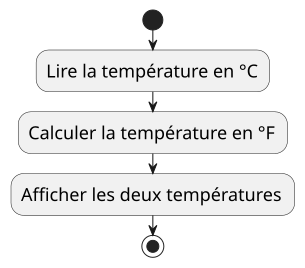

<!--
theme: custom-marp-theme
size: 16:9
paginate: true
author: V. Guidoux, avec l'aide de Claude
title: HEIG-VD ProgIM1 Course - Du diagramme au code
description: Séance "Du diagramme au code" - poser un problème, lire au clavier, afficher un résultat - pour l'unité d'enseignement ProgIM1 enseignée à la HEIG-VD, Suisse
url: https://heig-vd-progim-course.github.io/heig-vd-progim1-course/presentations/04-du-diagramme-au-code/
header: "**Du diagramme au code**"
footer: '[**HEIG-VD**](https://heig-vd.ch) - [ProgIM1 2026-2027](https://heig-vd-progim-course.github.io/heig-vd-progim1-course/) - [CC BY-SA 4.0](https://github.com/heig-vd-progim-course/heig-vd-progim1-course/blob/main/LICENSE.md)'
headingDivider: 2
math: mathjax
-->

# Du diagramme au code

<!--
_class: lead
_paginate: false
-->

<https://github.com/heig-vd-progim-course/heig-vd-progim1-course>

[Support de cours][cours] · [Présentation (web)][presentation-web] ·
[Présentation (PDF)][presentation-pdf]

<small>V. Guidoux, avec l'aide de Claude.</small>

<small>Ce travail est sous licence [CC BY-SA 4.0][license].</small>

## _Retrouvez plus de détails dans le support de cours_

<!-- _class: lead -->

_Cette présentation est un résumé du support de cours. Pour plus de détails,
consultez le [support de cours][cours]._

## La semaine dernière

- Un programme Java se compile, puis s'exécute.
- Deux familles d'erreurs : **compilation** et **exécution**.
- Une variable a un type, un nom, une valeur.
- `0.1 + 0.2` ne vaut pas `0.3`.

Mais vos programmes ne savent répéter que les valeurs écrites dedans.

## Objectifs de cette séance (1/2)

À la fin de cette séance, vous devriez être capable de :

- calculer en respectant l'ordre des opérations ;
- poser un problème en entrées, traitement, sortie ;
- lire une valeur au clavier et la convertir.

## Objectifs de cette séance (2/2)

- afficher un résultat lisible ;
- traduire un diagramme en Java ;
- repérer ce que l'énoncé ne couvre pas.

## Le programme de la séance

| Partie                         | Durée  |
| :----------------------------- | -----: |
| Les opérations arithmétiques   | 25 min |
| Poser le problème              | 30 min |
| Lire au clavier                | 30 min |
| Afficher un résultat lisible   | 30 min |
| Atelier - du diagramme au code | 45 min |
| Discussion des solutions       | 10 min |

## Le fil rouge démarre

<!-- _class: lead -->

> Calculer la moyenne des notes d'un groupe de personnes et dire qui a réussi.

Aujourd'hui : deux notes, une moyenne. Il sera réécrit à chaque séance.

## Les opérations arithmétiques

<!-- _class: lead -->

## Cinq opérateurs

| Code      | Résultat | Opération                  |
| :-------- | -------: | :------------------------- |
| `7 + 2`   | `9`      | Addition                   |
| `7 - 2`   | `5`      | Soustraction               |
| `7 * 2`   | `14`     | Multiplication             |
| `7 / 2`   | `3`      | Division, **entière** ici  |
| `7 % 2`   | `1`      | Reste de la division       |
| `7.0 / 2` | `3.5`    | Division                   |

## À quoi sert le reste

```java
int totalMinutes = 135;
int hours = totalMinutes / 60;
int minutes = totalMinutes % 60;
System.out.println(hours + " h " + minutes + " min");
```

```text
2 h 15 min
```

Unités complètes avec `/`, ce qui dépasse avec `%`.

## L'ordre des opérations

`*`, `/`, `%` avant `+`, `-`. Puis de gauche à droite.

```java
System.out.println(grade1 + grade2 / 2);    // 4.0 et 5.0
System.out.println((grade1 + grade2) / 2);
```

```text
6.5
4.5
```

Pas d'erreur, un résultat plausible, et faux. **Dans le doute, des
parenthèses.**

## Quand l'ordre change le type

```java
double celsius = 20;
System.out.println(celsius * 9 / 5 + 32);
System.out.println(9 / 5 * celsius + 32);
```

```text
68.0
52.0
```

`9 / 5` est calculé en premier, entre deux entiers : `1`.

## Raccourcis et `Math`

| Écriture         | Équivaut à / calcule  |
| :--------------- | :-------------------- |
| `score += 5`     | `score = score + 5`   |
| `score++`        | `score = score + 1`   |
| `Math.pow(2, 10)` | `1024.0`             |
| `Math.sqrt(16)`  | `4.0`                 |
| `Math.round(4.5)` | `5`                  |

## `^` n'est pas la puissance

<!-- _class: lead -->

```java
System.out.println(2 ^ 10);
```

```text
8
```

Ça compile, et ce n'est pas `1024`. La puissance, c'est `Math.pow`.

## Poser le problème

<!-- _class: lead -->

Avant d'écrire une ligne de code.

## Trois colonnes

| Entrées         | Traitement        | Sortie          |
| :-------------- | :---------------- | :-------------- |
| Ce qu'il reçoit | Ce qu'il calcule  | Ce qu'il rend   |
| Une température en °C | `celsius * 9 / 5 + 32` | La température en °F |

Trois colonnes, trois actions dans le diagramme.

## Le diagramme qui en découle

<!-- _class: lead -->



## Ce que l'énoncé ne dit pas

- Une température négative ?
- Combien de décimales ?
- Et si quelqu'un tape _"vingt"_ ?

Une question non écrite devient un bogue.

Quand vous ne pouvez pas trancher : écrivez une **hypothèse**.

## À vous

1. La moyenne de deux notes.
2. Le temps d'un trajet à pied.
3. Le partage d'une addition au restaurant.

Pour chacun : les trois colonnes, trois questions ouvertes, vos hypothèses.
Sur papier ou dans un fichier texte.

## Discussion

- Qu'avez-vous mis comme entrées ?
- Quelles questions avez-vous trouvées ?
- Quelles hypothèses avez-vous faites, et pourquoi ?

_"Des trucs"_ n'est pas une entrée.

## Lire au clavier

<!-- _class: lead -->

## `IO.readln`

```java
String firstName = IO.readln("Votre prénom : ");
System.out.println("Bonjour " + firstName);
```

```text
Votre prénom : Camille
Bonjour Camille
```

Affiche la question, **attend** une ligne, la rend.

Cliquez dans la console avant de taper.

## Ce qui revient est du texte

```java
String grade = IO.readln("Votre note : ");
System.out.println(grade + 1);
```

```text
Votre note : 4.5
4.51
```

`"4.5"` n'est pas `4.5`. Vous l'avez vu en séance 03.

## Java ne convertit pas pour vous

```java
double grade = IO.readln("Votre note : ");
```

Le compilateur refuse, à cette ligne :

`error: incompatible types: String cannot be converted to double`

Erreur de **compilation**. Il faut lui demander de convertir.

## Convertir

```java
double grade = Double.parseDouble(IO.readln("Votre note : "));
int age = Integer.parseInt(IO.readln("Votre âge : "));
```

`Double.parseDouble` pour un nombre à virgule.

`Integer.parseInt` pour un entier.

## Ça compile, et ça plante

```text
Votre note : 4,5
```

La première ligne de la trace :

`java.lang.NumberFormatException: For input string: "4,5"`

Erreur à l'**exécution**. Même chose avec rien, `quatre`, ou `20.5` pour un
entier. Trace complète dans le support.

## Lire le message

Deux lignes suffisent :

- la **première** : ce qui s'est passé, et le texte fautif ;
- la dernière qui parle de **`Main`** : la ligne de votre code.

Le reste, c'est l'intérieur de Java.

**Le séparateur décimal est le point.** À la saisie comme dans le code.

## On n'y peut rien, pour l'instant

Vérifier une saisie, c'est poser une question et agir selon la réponse.

C'est la séance 06.

Aujourd'hui, on **écrit l'hypothèse** : _"on suppose que la personne tape un
nombre, avec un point"_.

## Afficher un résultat lisible

<!-- _class: lead -->

## `println` ne suffit pas

```java
System.out.println((4.7 + 4.4) / 2);
System.out.println((3.3 + 4.6) / 2);
```

```text
4.550000000000001
3.9499999999999997
```

Juste, et illisible.

## `printf` : un modèle et des valeurs

```java
System.out.printf("%s a obtenu %.1f de moyenne.%n", name, average);
```

```text
Camille a obtenu 4.8 de moyenne.
```

| `%s` | `%d` | `%.1f` | `%n` |
| :--- | :--- | :----- | :--- |
| texte | entier | une décimale | à la ligne |

## `printf` se trompe à l'exécution

- `%d` avec un `double` : `IllegalFormatConversionException`.
- Un trou sans valeur : `MissingFormatArgumentException`.
- Pas de `%n` : la ligne suivante se colle.

Le compilateur ne vérifie pas le modèle.

## Le point ou la virgule

```java
System.out.printf("%.2f%n", 4.75);
```

| Ordinateur réglé en | Affichage |
| :------------------ | :-------- |
| anglais, allemand de Suisse | `4.75` |
| français            | `4,75`    |

`printf` suit la langue de l'ordinateur. `parseDouble` exige un point.

## Afficher arrondi n'est pas arrondir

Notes 3.3 et 4.6. Moyenne exacte : 3.95, soit 4.0 au dixième.

```text
Camille a obtenu 3.9 de moyenne.
```

`printf` arrondit `3.9499999999999997`, la valeur stockée.

Une note insuffisante au lieu d'une note suffisante.

## Arrondir la valeur

```java
double rounded = Math.round(average * 10) / 10.0;
System.out.printf("Moyenne : %.1f%n", rounded);
```

```text
Moyenne : 4.0
```

`10.0`, pas `10` : sinon, division entière.

## Atelier - du diagramme au code

<!-- _class: lead -->

**Le diagramme d'abord, le code ensuite.**

## La méthode

1. Le diagramme.
2. Le tableau de tests, **avant** le code.
3. Le code, un commentaire par rectangle.
4. Vérifier chaque ligne du tableau.
5. Essayer de le casser.

## Le tableau de tests, avant le code

| Première note | Deuxième note | Moyenne affichée attendue |
| ------------: | ------------: | :------------------------ |
|             4 |             5 |                           |
|           4.5 |             5 |                           |
|             6 |             6 |                           |
|             1 |             6 |                           |
|           3.3 |           4.6 |                           |

## Trois raisons d'un résultat faux

- Votre calcul est faux.
- Votre code ne fait pas ce que dit le diagramme.
- Votre diagramme ne fait pas ce que dit l'énoncé.

Il faut savoir laquelle.

## Essayer de le casser

Tapez `4,5`, rien, `quatre`, puis `7` et `8`.

Compilation, exécution, ou rien du tout ?

Le dernier cas est le plus inquiétant. Notez-le.

## À vous de jouer !

- Terminer le fil rouge : il sert dès la séance 05.
- Faire au moins une extension, diagramme compris.
- Lister les cas que votre programme ne gère pas.

## Questions

<!-- _class: lead -->

Est-ce que vous avez des questions ?

<!-- URLs -->

[presentation-web]:
	https://heig-vd-progim-course.github.io/heig-vd-progim1-course/presentations/04-du-diagramme-au-code/
[presentation-pdf]:
	https://heig-vd-progim-course.github.io/heig-vd-progim1-course/presentations/04-du-diagramme-au-code/04-du-diagramme-au-code-presentation.pdf
[cours]:
	https://heig-vd-progim-course.github.io/heig-vd-progim1-course/01-seances/04-du-diagramme-au-code/
[license]:
	https://github.com/heig-vd-progim-course/heig-vd-progim1-course/blob/main/LICENSE.md
