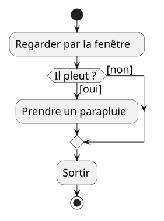
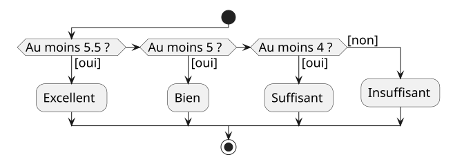

<!--
theme: custom-marp-theme
size: 16:9
paginate: true
author: V. Guidoux, avec l'aide de Claude
title: HEIG-VD ProgIM1 Course - Conditions
description: Séance "Conditions" - if, else, opérateurs de comparaison et logiques, switch, opérateur ternaire - pour l'unité d'enseignement ProgIM1 enseignée à la HEIG-VD, Suisse
url: https://heig-vd-progim-course.github.io/heig-vd-progim1-course/presentations/06-conditions/
header: "**Conditions**"
footer: '[**HEIG-VD**](https://heig-vd.ch) - [ProgIM1 2026-2027](https://heig-vd-progim-course.github.io/heig-vd-progim1-course/) - [CC BY-SA 4.0](https://github.com/heig-vd-progim-course/heig-vd-progim1-course/blob/main/LICENSE.md)'
headingDivider: 2
math: mathjax
-->

# Conditions

<!--
_class: lead
_paginate: false
-->

<https://github.com/heig-vd-progim-course/heig-vd-progim1-course>

[Support de cours][cours] · [Présentation (web)][presentation-web] ·
[Présentation (PDF)][presentation-pdf]

<small>V. Guidoux, avec l'aide de Claude.</small>

<small>Ce travail est sous licence [CC BY-SA 4.0][license].</small>

## _Retrouvez plus de détails dans le support de cours_

<!-- _class: lead -->

_Cette présentation est un résumé du support de cours. Pour plus de détails,
consultez le [support de cours][cours]._

## Pas à l'évaluation écrite

<!-- _class: lead -->

L'évaluation écrite du **lundi 9 novembre** porte sur les séances **01 à 05**.

Les conditions **n'y sont pas**. Elles seront à l'évaluation finale.

## La semaine dernière : prédisez (1/3)

```java
public class Main {
    public static void printMiddle() {
        System.out.println("2");
        System.out.println("3");
        System.out.println("4");
    }

    public static void main(String[] args) {
        System.out.println("1");
        printMiddle();
        System.out.println("5");
    }
}
```

## `1 2 3 4 5`

<!-- _class: lead -->

Un programme commence **toujours** par `main`.

Les lignes 3 à 5 sont écrites **avant** la ligne 9, mais s'exécutent
**après**.

L'ordre d'exécution n'est pas l'ordre du fichier.

## La semaine dernière : prédisez (2/3)

Trois fonctions. Cette fois, les nombres sont dans l'ordre du fichier.

```java
public class Main {
    public static void printInner() {
        System.out.println("1");
    }

    public static void printOuter() {
        System.out.println("2");
        printInner();
        System.out.println("3");
    }
```

## La semaine dernière : prédisez (3/3)

```java
    public static void main(String[] args) {
        System.out.println("4");
        printOuter();
        System.out.println("5");
    }
}
```

Qu'affiche ce programme, ligne après ligne ?

## `4 2 1 3 5`

1. `main` affiche `4`, puis appelle `printOuter` et attend.
2. `printOuter` affiche `2`, puis appelle `printInner` et attend.
3. `printInner` affiche `1`, et rend la main.
4. `printOuter` reprend et affiche `3`, et rend la main.
5. `main` reprend et affiche `5`.

## Aujourd'hui

<!-- _class: lead -->

Jusqu'ici, **toutes** les lignes s'exécutent.

Aujourd'hui, certaines vont être **sautées**.

## Objectifs de cette séance (1/2)

À la fin de cette séance, vous devriez être capable de :

- traduire un losange en `if` et `else` ;
- écrire une condition, et distinguer `=` de `==` ;
- écrire une fonction qui rend un `boolean` ;
- choisir entre plusieurs cas avec `else if`, dans le bon ordre.

## Objectifs de cette séance (2/2)

- combiner des conditions avec `&&`, `||` et `!` ;
- tester une condition à chaque limite ;
- expliquer pourquoi on ne compare pas deux `double` avec `==` ;
- lire et écrire l'opérateur ternaire et `switch`.

## Le losange de la séance 01



## Le même, en Java

```java
public class Main {
    public static void main(String[] args) {
        boolean isRaining = true;

        System.out.println("Regarder par la fenêtre");
        if (isRaining) {
            System.out.println("Prendre un parapluie");
        }
        System.out.println("Sortir");
    }
}
```

Avec `false`, la ligne 7 est sautée.

## Une condition vaut `true` ou `false`

| Opérateur | Se lit                   | Exemple      | Vaut    |
| :-------: | :----------------------- | :----------- | :------ |
|   `==`    | est égal à               | `4.5 == 4.5` | `true`  |
|   `!=`    | est différent de         | `4.5 != 4.5` | `false` |
|    `<`    | est plus petit que       | `3.5 < 4`    | `true`  |
|   `<=`    | est plus petit ou égal à | `4 <= 4`     | `true`  |
|    `>`    | est plus grand que       | `3.5 > 4`    | `false` |
|   `>=`    | est plus grand ou égal à | `4 >= 4`     | `true`  |

## Quiz

<!-- _class: lead -->

`average` vaut 4. Que vaut `average > 4` ?

A. `true` - B. `false` - C. `4` - D. Une erreur de compilation

## B. `false`

<!-- _class: lead -->

`>` est **strictement** plus grand. Pour inclure 4 : `>=`.

Une condition se teste avec **trois** valeurs : une vraie, une fausse, **la
limite**.

## `=` range, `==` compare

`if (average = 4) {`

`Main.java:5: error: incompatible types: double cannot be converted to boolean`

- `average = 4` range 4 dans `average`. Le résultat est un `double`.
- Un `if` attend un `boolean`.
- Correction : `if (average == 4)`.

## `if` et `else` : un seul des deux blocs

```java
public class Main {
    public static void main(String[] args) {
        double average = 3.5;

        if (average >= 4) {
            System.out.println("Réussi");
        } else {
            System.out.println("Échoué");
        }
        System.out.println("Fin du programme");
    }
}
```

## Toujours des accolades, jamais de `;`

- Un `if` sans accolades ne contrôle que la ligne suivante. Une deuxième ligne
  ajoutée plus tard s'exécute **toujours**.
- `if (average >= 4);` compile. Le `;` termine le `if`, et le bloc qui suit
  s'exécute **toujours**.

Dans ce cours : toujours des accolades.

## Une fonction qui répond oui ou non (1/2)

```java
public class Main {
    public static boolean hasPassed(double average) {
        if (average >= 4) {
            return true;
        } else {
            return false;
        }
    }
    public static void main(String[] args) {
        System.out.println(hasPassed(4.5));
        System.out.println(hasPassed(3.5));
    }
}
```

## Une fonction qui répond oui ou non (2/2)

```java
public class Main {
    public static boolean hasPassed(double average) {
        return average >= 4;
    }

    public static void main(String[] args) {
        System.out.println(hasPassed(4.5));
        System.out.println(hasPassed(3.5));
    }
}
```

Même sortie : `true` puis `false`. On rend **directement** la comparaison.

## Quiz

Laquelle est la plus simple **et** correcte ?

A. `return average > 4;`

B. `if (average >= 4) { return true; }`

C. `return average >= 4;`

D. `if (average >= 4 == true) { return true; } else { return false; }`

## C. `return average >= 4;`

- A refuse la note 4.
- B ne compile pas : `missing return statement`. Si la condition est fausse,
  rien n'est rendu.
- D est juste, mais fait en cinq lignes ce qu'une seule fait.

Un nom qui pose une question : `hasPassed`, `isValid`, `canVote`.

## Une variable déclarée dans un bloc

```java
if (average >= 4) {
    String verdict = "réussi";
} else {
    String verdict = "échoué";
}
System.out.println("Verdict : " + verdict);
```

`cannot find symbol` : chaque `verdict` disparaît à son accolade fermante.
Déclarez-la **avant** le `if`.

## Atelier - Décider

<!-- _class: lead -->

**Toute condition se teste avec trois valeurs : une qui la rend vraie, une qui
la rend fausse, et la valeur limite.**

## Le déroulé de l'atelier

1. **Prédire** : quatre programmes, prédiction écrite avant d'exécuter.
2. **Réparer** : quatre bugs placés exprès.
3. **Écrire** : trois fonctions qui rendent un `boolean`.
4. **Le fil rouge décide** : `hasPassed`, puis le verdict.

## Plus de deux chemins



## `else if` (1/2)

```java
public class Main {
    public static String describe(double average) {
        if (average >= 5.5) {
            return "Excellent";
        } else if (average >= 5) {
            return "Bien";
        } else if (average >= 4) {
            return "Suffisant";
        } else {
            return "Insuffisant";
        }
    }
```

## `else if` (2/2)

```java
    public static void main(String[] args) {
        System.out.println(describe(6));
        System.out.println(describe(5.2));
        System.out.println(describe(4));
        System.out.println(describe(3.5));
    }
}
```

`Excellent`, `Bien`, `Suffisant`, `Insuffisant`.

De haut en bas, et **seule la première condition vraie** compte.

## Quiz : on inverse l'ordre

```java
if (average >= 4) {
    return "Suffisant";
} else if (average >= 5) {
    return "Bien";
} else if (average >= 5.5) {
    return "Excellent";
} else {
    return "Insuffisant";
}
```

`describe(6)` ? A. `Excellent` - B. `Bien` - C. `Suffisant` - D. Erreur

## C. `"Suffisant"`

<!-- _class: lead -->

`6 >= 4` est vrai dès la première ligne. `Bien` et `Excellent` ne sont
**jamais** atteints.

Aucune erreur de compilation. Avec `>=`, du plus grand au plus petit.

## Deux `if` ou `else if` ?

Avec `average` à 5.5 :

| Code                                | Affiche              |
| :---------------------------------- | :------------------- |
| `if (>= 5)` puis `if (>= 4)`        | `Bien` et `Suffisant` |
| `if (>= 5)` puis `else if (>= 4)`   | `Bien`               |

Deux `if` sont **indépendants**. Si les cas s'excluent : `else if`.

## Combiner des conditions

| `a`     | `b`     | `a && b` | `a \|\| b` | `!a`    |
| :------ | :------ | :------- | :--------- | :------ |
| `true`  | `true`  | `true`   | `true`     | `false` |
| `true`  | `false` | `false`  | `true`     | `false` |
| `false` | `true`  | `false`  | `true`     | `true`  |
| `false` | `false` | `false`  | `false`    | `true`  |

`&&` : les deux. `||` : au moins une. `!` : l'inverse.

## Entre 1 et 6

```java
public class Main {
    public static boolean isValidGrade(double grade) {
        return (grade >= 1) && (grade <= 6);
    }

    public static void main(String[] args) {
        System.out.println(isValidGrade(0.5));
        System.out.println(isValidGrade(1));
        System.out.println(isValidGrade(4.5));
        System.out.println(isValidGrade(6));
        System.out.println(isValidGrade(6.5));
    }
}
```

## Pas de `1 <= grade <= 6`

`return 1 <= grade <= 6;`

`Main.java:3: error: bad operand types for binary operator '<='`

- Java calcule d'abord `1 <= grade` : un `boolean`.
- Puis `true <= 6` : n'a pas de sens.
- Une comparaison par condition, des parenthèses autour de chacune.

## Quiz

Quelle condition est vraie quand `grade` est entre 1 et 6, limites comprises ?

A. `1 <= grade <= 6`

B. `(grade >= 1) || (grade <= 6)`

C. `(grade >= 1) && (grade <= 6)`

D. `(grade > 1) && (grade < 6)`

## C. `(grade >= 1) && (grade <= 6)`

- A ne compile pas.
- B est **toujours** vraie, même pour 7.
- D refuse les limites, 1 et 6.

## Ne comparez pas deux `double` avec `==`

`computeAverage(3.3, 4.6)` vaut `3.9499999999999997`.

| Expression                      | Vaut    |
| :------------------------------ | :------ |
| `average == 3.95`               | `false` |
| `(0.1 + 0.2) == 0.3`            | `false` |
| `hasPassed(average)`            | `false` |
| `hasPassed(roundToTenth(average))` | `true`  |

Décidez sur la valeur **arrondie**, celle qu'on affiche.

## Couvrir tous les cas : chaque limite

| Valeur     | Attendu                 |
| :--------- | :---------------------- |
| 6, 5.5     | Excellent               |
| 5.4, 5     | Bien                    |
| 4.9, 4     | Suffisant               |
| 3.9, 1     | Insuffisant             |

Chaque frontière est un endroit où un `>` à la place d'un `>=` passe inaperçu.

## Atelier - Couvrir tous les cas

<!-- _class: lead -->

**Avant d'écrire une suite de conditions, écrivez le tableau des cas qu'elle
doit couvrir, avec une valeur de chaque côté de chaque limite.**

## Le déroulé de l'atelier

1. **Prédire** : deux programmes.
2. **Réparer** : trois bugs placés exprès.
3. **Écrire** : `ticketPrice`, `isWeekend`, `isLeapYear`.
4. **Le fil rouge se protège** : `isValidGrade`, puis `describe`.
5. **La chasse** : faites mentir le programme de votre voisin.

## L'opérateur ternaire

Choisir entre **deux valeurs** :

`condition ? valeur si vrai : valeur si faux`

La déclaration de `verdict`, le `if` et le `else` deviennent une seule
ligne :

`String verdict = hasPassed(average) ? "réussi" : "échoué";`

## Pour des valeurs, pas pour des actions

`(average >= 4) ? System.out.println("Réussi") : ...`

`Main.java:4: error: not a statement`

- Le ternaire rend une **valeur**. Pour faire l'une ou l'autre chose : `if`.
- `return (average >= 4) ? true : false;` est juste, mais inutile :
  `return average >= 4;`.

## Quiz

<!-- _class: lead -->

`age` vaut 16. Que contient `price` ?

`int price = (age < 16) ? 10 : 20;`

A. `10` - B. `20` - C. `true` - D. Rien, la ligne ne compile pas

## B. `20`

<!-- _class: lead -->

`16 < 16` est faux : on prend la valeur après les deux-points.

Le résultat est un `int`, pas le `boolean` de la condition.

## `switch` : des valeurs exactes (1/2)

```java
public class Main {
    public static String dayName(int day) {
        return switch (day) {
            case 1 -> "lundi";
            case 2 -> "mardi";
            case 3 -> "mercredi";
            case 4 -> "jeudi";
            case 5 -> "vendredi";
            case 6 -> "samedi";
            case 7 -> "dimanche";
            default -> "inconnu";
        };
    }
```

## `switch` : des valeurs exactes (2/2)

```java
    public static void main(String[] args) {
        System.out.println(dayName(1));
        System.out.println(dayName(5));
        System.out.println(dayName(9));
    }
}
```

`lundi`, `vendredi`, `inconnu`.

Avec `else if`, `day ==` aurait été écrit sept fois.

## Plusieurs valeurs, et un `default` obligatoire

`case 1, 3, 5, 7, 8, 10, 12 -> 31;`

`case 4, 6, 9, 11 -> 30;`

Sans `default` :

`error: the switch expression does not cover all possible input values`

Un `int` peut valoir 8, 0 ou -12. Que rendre ?

## Un `switch` sur du texte

```java
public class Main {
    public static void main(String[] args) {
        String choice = IO.readln("Votre choix (a, b ou q) : ");

        switch (choice) {
            case "a" -> System.out.println("Calculer une moyenne");
            case "b" -> System.out.println("Afficher le verdict");
            case "q" -> System.out.println("Au revoir");
            default -> System.out.println("Choix inconnu : " + choice);
        }
    }
}
```

## Et avec `==` ? Prédisez

```java
public class Main {
    public static void main(String[] args) {
        String choice = IO.readln("Votre choix (a, b ou q) : ");

        if (choice == "a") {
            System.out.println("Calculer une moyenne");
        } else {
            System.out.println("Choix inconnu : " + choice);
        }
    }
}
```

On tape `a`.

## `Choix inconnu : a`

<!-- _class: lead -->

Pour du texte, `==` **ne compare pas** le texte. Ça compile, et c'est faux.

Pourquoi, et comment faire : séance 09. D'ici là, un `switch`.

## Ce que `switch` ne sait pas faire

- Des **intervalles** : _"5.5 ou plus"_. C'est le travail de `else if`.
- Des `double` : `switch selector type double` ne compile pas.

## Quiz

Pour laquelle un `switch` est-il le bon choix ?

A. `describe(double average)`, l'appréciation d'une moyenne

B. `ticketPrice(int age)`, gratuit avant 6 ans, 10 francs avant 16

C. `monthName(int month)`, _"janvier"_ pour 1, _"février"_ pour 2...

D. `isValidGrade(double grade)`, entre 1 et 6

## C. `monthName`

<!-- _class: lead -->

Seul `monthName` associe une **valeur exacte** à chaque résultat.

Les trois autres testent des **intervalles**.

## Quelle forme choisir ?

| Situation                                | Forme                |
| :--------------------------------------- | :------------------- |
| Faire quelque chose, ou rien             | `if`                 |
| L'une ou l'autre de deux choses          | `if` et `else`       |
| Plusieurs cas, des intervalles           | `else if`            |
| Plusieurs cas, des valeurs exactes       | `switch`             |
| Choisir entre deux **valeurs**           | ternaire             |

Dans le doute, `if` et `else` marchent toujours.

## Atelier - partie 6

<!-- _class: lead -->

Le verdict du fil rouge avec le ternaire.

`isWeekend` et `daysInMonth` avec `switch`.

Le jour oublié.

## À vous de jouer !

- Terminer le fil rouge jusqu'à la partie 6.
- La partie _Écrire_ des deux ateliers, avec ses tableaux de tests.
- Refaire les quiz du support dans une semaine, sans relire avant.
- Si votre évaluation écrite n'a pas eu lieu : l'examen blanc d'abord.

## Questions

<!-- _class: lead -->

Est-ce que vous avez des questions ?

<!-- URLs -->

[presentation-web]:
	https://heig-vd-progim-course.github.io/heig-vd-progim1-course/presentations/06-conditions/
[presentation-pdf]:
	https://heig-vd-progim-course.github.io/heig-vd-progim1-course/presentations/06-conditions/06-conditions-presentation.pdf
[cours]:
	https://heig-vd-progim-course.github.io/heig-vd-progim1-course/01-seances/06-conditions/
[license]:
	https://github.com/heig-vd-progim-course/heig-vd-progim1-course/blob/main/LICENSE.md
