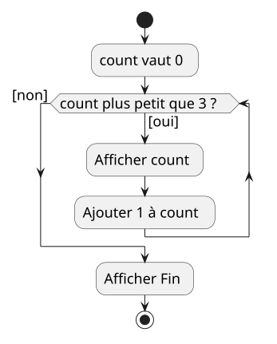

<!--
theme: custom-marp-theme
size: 16:9
paginate: true
author: V. Guidoux, avec l'aide de Claude
title: HEIG-VD ProgIM1 Course - Boucles
description: Séance "Boucles" - while, for, do-while, trois ingrédients d'une boucle, tableau de trace - pour l'unité d'enseignement ProgIM1 enseignée à la HEIG-VD, Suisse
url: https://heig-vd-progim-course.github.io/heig-vd-progim1-course/presentations/07-boucles/
header: "**Boucles**"
footer: '[**HEIG-VD**](https://heig-vd.ch) - [ProgIM1 2026-2027](https://heig-vd-progim-course.github.io/heig-vd-progim1-course/) - [CC BY-SA 4.0](https://github.com/heig-vd-progim-course/heig-vd-progim1-course/blob/main/LICENSE.md)'
headingDivider: 2
math: mathjax
-->

# Boucles

<!--
_class: lead
_paginate: false
-->

<https://github.com/heig-vd-progim-course/heig-vd-progim1-course>

[Support de cours][cours] · [Présentation (web)][presentation-web] ·
[Présentation (PDF)][presentation-pdf]

<small>V. Guidoux, avec l'aide de Claude.</small>

<small>Ce travail est sous licence [CC BY-SA 4.0][license].</small>

## _Retrouvez plus de détails dans le support de cours_

<!-- _class: lead -->

_Cette présentation est un résumé du support de cours. Pour plus de détails,
consultez le [support de cours][cours]._

## Les boucles sont à l'évaluation finale

<!-- _class: lead -->

L'évaluation écrite portait sur les séances **01 à 05**.

Les boucles seront à l'**évaluation finale**, et dans le mini-projet dès la
séance 08.

## La semaine dernière : les conditions

- Le **losange** devient `if` et `else` : exactement un des deux blocs
  s'exécute.
- Une condition vaut `true` ou `false`. `=` range, `==` compare.
- Avec `else if`, **la première condition vraie gagne**.
- Toute condition se teste avec **trois valeurs** : vraie, fausse, la limite.
- `switch` pour des valeurs exactes, le ternaire pour choisir une valeur.

## Le fil rouge, à la fin de la séance 06

<!-- _class: lead -->

Lou tape 7 : le programme répond _"note invalide"_... et passe à la suite.

Il traite **trois** personnes de **deux** notes, pas une de plus.

Pour faire mieux, il faut **répéter**.

## Rappel : prédisez

```java
public class Main {
    public static void main(String[] args) {
        int count = 0;

        if (count < 3) {
            System.out.println(count);
            count++;
        }
        System.out.println("Fin");
    }
}
```

A. `0 1 2 Fin` - B. `0 Fin` - C. `0 1 2 3 Fin` - D. `Fin`

## B. `0 Fin`

<!-- _class: lead -->

Le bloc s'exécute **une fois**, puis Java continue à la ligne 9.

Un `if` décide une fois. **Il ne répète pas.**

Si vous avez répondu A, vous avez lu ce programme comme une boucle.

## Objectifs de cette séance (1/2)

À la fin de cette séance, vous devriez être capable de :

- traduire une flèche qui remonte en boucle `while` ;
- nommer les trois ingrédients d'une boucle ;
- dérouler une boucle à la main, dans un tableau de trace ;
- dire à quel moment la condition d'une boucle est posée.

## Objectifs de cette séance (2/2)

- repérer une boucle infinie et un tour de trop ou de moins ;
- accumuler une somme et compter dans une boucle ;
- réécrire une boucle qui compte avec `for` ;
- choisir entre `for` et `while`, et reconnaître `do-while`.

## La flèche qui remonte



## Remplacer `if` par `while` (ligne 5)

```java
public class Main {
    public static void main(String[] args) {
        int count = 0;

        while (count < 3) {
            System.out.println(count);
            count++;
        }
        System.out.println("Fin");
    }
}
```

`0`, `1`, `2`, `Fin`. Un seul mot a changé.

## Du diagramme au code

| Dans le diagramme     | En Java                                     |
| :-------------------- | :------------------------------------------ |
| Le losange            | `while`                                     |
| La question           | La **condition**, entre parenthèses         |
| Le chemin `[oui]`     | Le **corps** de la boucle                   |
| La flèche qui remonte | L'accolade fermante : retour à la condition |
| Le chemin `[non]`     | La ligne qui suit l'accolade fermante       |

Une exécution du corps est un **tour**.

## Les trois ingrédients (lignes 3, 5 et 7)

```java
public class Main {
    public static void main(String[] args) {
        int i = 0;

        while (i <= 5) {
            System.out.println(i);
            i++;
        }
        System.out.println("Fin");
    }
}
```

## Situation initiale, condition, mise à jour

| Ingrédient                | Ligne | Rôle                                   |
| :------------------------ | :---: | :------------------------------------- |
| La **situation initiale** |   3   | `int i = 0;` : d'où l'on part, avant   |
| La **condition**          |   5   | `i <= 5` : tant qu'elle est vraie      |
| La **mise à jour**        |   7   | `i++;` : ce qui change à chaque tour   |

Sans mise à jour, la boucle ne s'arrête plus.

## Dérouler une boucle : le tableau de trace

| Condition posée |  i  |  i <= 5  | Affiche | i en fin de tour |
| :-------------- | --: | :------: | :------ | -----------------: |
| 1re fois      |   0 |  `true`  | `0`     |                  1 |
| 2e fois       |   1 |  `true`  | `1`     |                  2 |
| ...             | ... |   ...    | ...     |                ... |
| 6e fois       |   5 |  `true`  | `5`     |                  6 |
| 7e fois       |   6 | `false`  | on sort |                    |

**Sept** fois la condition, **six** tours. _"De 0 à 5"_, c'est six nombres.

## Quiz : combien de `Bonjour` ?

```java
public class Main {
    public static void main(String[] args) {
        int i = 0;

        while (i < 5) {
            System.out.println("Bonjour");
            i++;
        }
    }
}
```

A. 4 fois - B. 5 fois - C. 6 fois - D. Sans fin

## B. 5 fois

<!-- _class: lead -->

`i` vaut 0, 1, 2, 3 et 4 dans le corps. À 5, `5 < 5` est faux.

`<` ou `<=` : un caractère, **un tour** de différence.

## Quiz : la mise à jour avant l'affichage

```java
public class Main {
    public static void main(String[] args) {
        int i = 0;

        while (i < 3) {
            i++;
            System.out.println(i);
        }
        System.out.println("Fin");
    }
}
```

A. `0 1 2 Fin` - B. `1 2 Fin` - C. `1 2 3 Fin` - D. `0 1 2 3 Fin`

## C. `1 2 3 Fin`

<!-- _class: lead -->

Au 3e tour, `i` passe à 3 : la condition devient fausse... mais Java ne la
regarde pas. Il finit le tour et affiche `3`.

La condition est une **porte à l'entrée du tour**. Elle n'est pas surveillée
en permanence.

## Zéro tour, ou une infinité

- `int i = 10;` puis `while (i <= 5)` : **zéro tour**. Seul `Fin`
  s'affiche. C'est permis.
- Sans `i++;` : `i` reste à 0, et `0` s'affiche **sans fin**. C'est une
  **boucle infinie**.
- `while (i <= 5);` : le `;` donne à la boucle un corps vide. Rien ne
  s'affiche, et rien ne s'arrête.

Pour arrêter : le **carré rouge** d'IntelliJ.

## Accumuler au fil des tours (lignes 3 et 7)

```java
public class Main {
    public static void main(String[] args) {
        int sum = 0;
        int i = 1;

        while (i <= 4) {
            sum = sum + i;
            i++;
        }
        System.out.println("Somme : " + sum);
    }
}
```

## L'accumulateur se déclare avant la boucle

Le programme affiche `Somme : 10`. `sum` est un **accumulateur** : elle part
de 0, et chaque tour lui ajoute quelque chose.

Déclaré dans le corps, `int sum = 0;` :

`Main.java:10: error: cannot find symbol`

- `sum` disparaît à l'accolade fermante de la boucle.
- Pire : elle repart de 0 **à chaque tour**.

Un **compteur** est un accumulateur qui ajoute 1 : `count++`.

## Redemander tant que c'est faux (1/2)

```java
public class Main {
    public static boolean isValidGrade(double grade) {
        return (grade >= 1) && (grade <= 6);
    }

    public static void main(String[] args) {
        double grade = Double.parseDouble(IO.readln("Note : "));

        while (!isValidGrade(grade)) {
            System.out.println("Note invalide, entre 1 et 6");
            grade = Double.parseDouble(IO.readln("Note : "));
        }
```

## Redemander tant que c'est faux (2/2)

```java
        System.out.println("Note acceptée : " + grade);
    }
}
```

| Ingrédient            | Ligne | Ici                                |
| :-------------------- | :---: | :--------------------------------- |
| La situation initiale |   7   | La première saisie                 |
| La condition          |   9   | La note est mauvaise               |
| La mise à jour        |  11   | Une nouvelle saisie                |

## Activité - Des boucles en chair et en os

<!-- _class: lead -->

**Avant de rejoindre qui que ce soit, déroulez votre boucle dans votre tête,
tour par tour.**

## Atelier - Dérouler et réparer

<!-- _class: lead -->

**Pour toute boucle, nommez ses trois ingrédients avant d'écrire la moindre
ligne, ou avant de chercher le moindre bug.**

## Les trois ingrédients sur une ligne

```java
public class Main {
    public static void main(String[] args) {
        for (int i = 0; i <= 5; i++) {
            System.out.println(i);
        }
        System.out.println("Fin");
    }
}
```

`for (situation initiale; condition; mise à jour)`

Même sortie que le `while` de 0 à 5.

## Dans quel ordre s'exécute un `for` ?

1. La situation initiale, **une seule fois**.
2. La condition : si elle est fausse, on sort.
3. Le corps.
4. La mise à jour, **à la fin du tour**, même si elle est écrite en haut.
5. Retour à l'étape 2.

Un doute ? **Réécrivez-le en `while`** : c'est la même boucle.

## Quiz

<!-- _class: lead -->

Dans la version `while` de 0 à 5, que vaut `i` quand on affiche `Fin` ?

A. 5 - B. 6 - C. 0 - D. `i` n'existe plus

## B. 6

<!-- _class: lead -->

La boucle s'arrête quand `i <= 5` devient faux : à 6.

Dans la version `for`, la réponse serait **D** : `i` n'existe plus.

## La variable du `for` reste dans le `for`

`System.out.println("i vaut " + i);` après la boucle :

`Main.java:6: error: cannot find symbol`

- `i`, déclarée dans les parenthèses, disparaît à l'accolade fermante.
- Un **accumulateur**, lui, sert après : déclaré **avant** le `for`.

## Compter autrement

- À rebours : `for (int i = 5; i >= 1; i--)` affiche `5 4 3 2 1`.
- De 2 en 2 : `for (int i = 0; i <= 8; i += 2)` affiche `0 2 4 6 8`.

Les trois ingrédients s'écrivent comme on veut.

## `for` ou `while` ?

| Avant d'entrer dans la boucle, je sais...     | Boucle  |
| :-------------------------------------------- | :------ |
| combien de tours elle va faire                | `for`   |
| seulement quand elle doit s'arrêter           | `while` |

Le nombre de notes tapé au clavier est connu **avant** : `for`.

Le nombre de saisies d'une note fausse ne l'est pas : `while`.

## Quiz

<!-- _class: lead -->

Un programme demande un mot de passe jusqu'à ce que le bon soit tapé.

A. `for` - B. `while` - C. `if` - D. Aucune

## B. `while`

<!-- _class: lead -->

Personne ne sait combien d'essais il faudra.

On peut **compter** les essais dans un `while` sans en faire un `for`.

## `do-while` : au moins un tour (1/2)

```java
public class Main {
    public static boolean isValidGrade(double grade) {
        return (grade >= 1) && (grade <= 6);
    }

    public static void main(String[] args) {
        double grade;

        do {
            grade = Double.parseDouble(IO.readln("Note : "));
        } while (!isValidGrade(grade));
        System.out.println("Note acceptée : " + grade);
```

## `do-while` : au moins un tour (2/2)

- La condition est posée **à la fin** du tour : toujours au moins un tour.
- La lecture n'est écrite **qu'une fois**.
- Le `;` après la condition est **obligatoire**. Après un `while`, il est un
  bug. C'est incohérent, et c'est Java.

Rare dans du vrai code : sachez la **reconnaître**.

## Trois boucles

| Boucle     | Condition posée | Tours minimum | Quand                     |
| :--------- | :-------------- | :-----------: | :------------------------ |
| `for`      | au début        |       0       | Nombre de tours connu     |
| `while`    | au début        |       0       | On sait quand s'arrêter   |
| `do-while` | à la fin        |       1       | Toujours un premier tour  |

## Atelier - `for` et FizzBuzz

<!-- _class: lead -->

**Avant d'écrire une boucle : est-ce que je sais combien de tours elle va
faire ? Oui : `for`. Non : `while`.**

## FizzBuzz

De 1 à 15, un nombre par ligne, mais :

- `Fizz` à la place des multiples de 3 ;
- `Buzz` à la place des multiples de 5 ;
- `FizzBuzz` à la place des multiples de 3 **et** de 5.

`1 2 Fizz 4 Buzz Fizz 7 8 Fizz Buzz 11 Fizz 13 14 FizzBuzz`

Un multiple de 3 : `(i % 3) == 0`.

## Le piège de l'ordre

<!-- _class: lead -->

Tester 3, puis 5, puis 15 : `FizzBuzz` ne s'affiche **jamais**.

15 est un multiple de 3 : la première condition vraie gagne.

Ce bug ne se voit qu'au **15e tour**.

## À vous de jouer !

- Terminer le fil rouge jusqu'à l'étape 2 de l'atelier _`for` et FizzBuzz_.
- La partie _Écrire_ du premier atelier, puis la même chose avec `for`.
- Le tableau de trace de FizzBuzz quand `i` vaut 14, 15, puis 16.
- Refaire les quiz et les remises en ordre dans une semaine.

## Questions

<!-- _class: lead -->

Est-ce que vous avez des questions ?

<!-- URLs -->

[presentation-web]:
	https://heig-vd-progim-course.github.io/heig-vd-progim1-course/presentations/07-boucles/
[presentation-pdf]:
	https://heig-vd-progim-course.github.io/heig-vd-progim1-course/presentations/07-boucles/07-boucles-presentation.pdf
[cours]:
	https://heig-vd-progim-course.github.io/heig-vd-progim1-course/01-seances/07-boucles/
[license]:
	https://github.com/heig-vd-progim-course/heig-vd-progim1-course/blob/main/LICENSE.md
